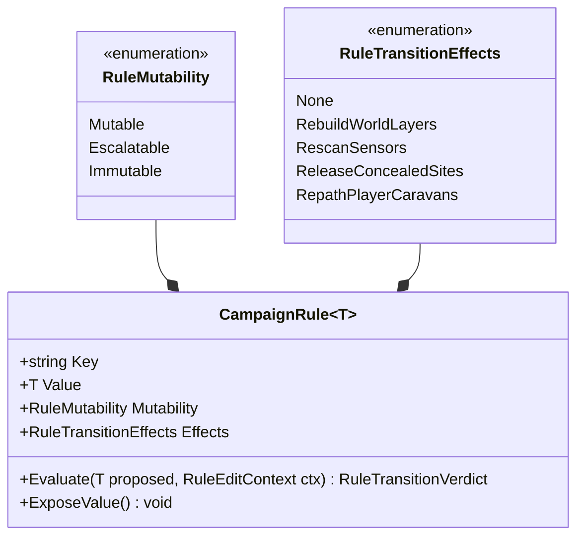
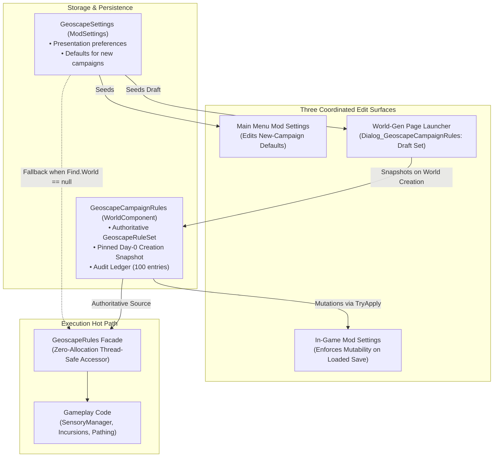
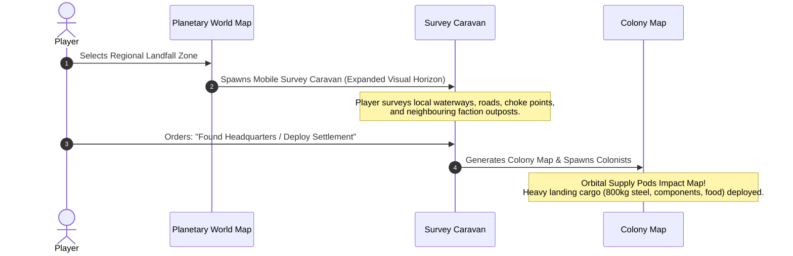

# Architectural Design Blueprint: Campaign Rules, Mutability Framework & Campaign Identity

**Module:** Project Vigilance: Geoscape (`ProjectVigilance.Geoscape`)  
**Target Release:** Milestone 1.3 (Core Framework) & Milestone 1.4 (Expedition Runway)  
**Status:** Approved Architectural Specification

---

## 1. Executive Summary & Epistemic Foundations

### 1.1 The Twin Epistemic Principles

Project Vigilance transforms RimWorld's grand strategy layer from an omniscient base-builder into an authentic simulation of strategic reconnaissance, intelligence gathering, and operational uncertainty. This design rests upon two complementary principles:

> **1. "You don't know what you don't know."**  
> _To know, you need to find out — investigate, identify, research, explore._
>
> **2. "Information must be earned, not guessed."**  
> _Uncertainty is not arbitrary blindness; every unknown has an actionable, strategic path to discovery._

In vanilla RimWorld, players are granted passive, omniscient intelligence. At the world scale, the entire planet is unveiled as a fully-charted atlas from Day 0. When a raid or incident occurs, an explicit letter reveals the attacking faction, threat budget, pawn roster, armour sets, and weaponry.

Project Vigilance fundamentally rejects passive omniscience:

- **Earned Intelligence:** Information is an active strategic commodity. Threat vectors, force compositions, and dynamic camps must be discovered through deliberate player initiative: building lookout networks, deploying radar arrays, establishing forward listening posts, and sending scout caravans.
- **Eliminating the Blind Guessing Paradox:** While the planet begins in darkness, players must never be forced to make permanent, game-defining commitments through blind guesswork. True exploration provides the tools to survey, probe, and uncover actionable intelligence before committing irreversible resources.

---

### 1.2 The Campaign Identity Equation

In the legacy architecture, several gameplay-affecting settings were stored exclusively within global `ModSettings` (application state) rather than being persisted with individual save games. As a consequence, modifying a setting in one campaign silently contaminated every other save loaded on that machine.

Project Vigilance establishes that campaign-affecting settings belong strictly to save data, formalising the **Campaign Identity Equation**:

$$\mathbf{Campaign\ Identity} = \mathbf{Scenario} + \mathbf{World\ Seed} + \mathbf{Storyteller\ \&\ Difficulty} + \mathbf{Campaign\ Rules}$$

```
┌──────────────────────────────────────────────────────────────────────────────────┐
│                          THE CAMPAIGN IDENTITY PILLARS                           │
├──────────────────────────┬───────────────────────────────────────────────────────┤
│ Pillar                   │ Strategic Function                                    │
├──────────────────────────┼───────────────────────────────────────────────────────┤
│ Scenario                 │ Starting assets, pawn demographics, faction relations │
│ World Seed & Coverage    │ Physical topography, continents, and biome geography  │
│ Storyteller & Difficulty │ Threat frequency, raid scaling, and wealth curves     │
│ Campaign Rules           │ Epistemic visibility, AI coordination, stealth laws   │
└──────────────────────────┴───────────────────────────────────────────────────────┘
```

A save file is an authoritative historical record. Its simulation rules cannot be altered simply because another campaign was played in the meantime.

---

## 2. Planetary Visibility: Shifting the Default to Classic Haze of War

### 2.1 The Earth vs Uncharted Rimworld Distinction

In Julian Gollop's original 1994 _X-COM: UFO Defense_, the Geoscape depicted **Earth**. Players already knew the geographic locations of North America, Europe, Asia, and the oceans. The unknown was alien activity: UFO flight trajectories, secret infiltration, and alien terror sites. _Planetary Surveillance_ (known geography, hidden movement) was the authentic default.

In RimWorld, however:

- Every world is an uncharted, procedurally generated frontier planet.
- There are no predetermined continents, coastlines, mountain ranges, or established nations.
- Handing the player a complete topographic atlas on Day 0 destroys the mystery of arrival and renders early-game scouting towers, signal beacons, and exploratory caravans strategically redundant.

### 2.2 Three-Tier Play Style Positioning

To align with _"Information must be earned, not guessed"_, **Classic Haze of War becomes the canonical recommended default**:

```
┌──────────────────────────────────────────────────────────────────────────────────┐
│                         PLANETARY VISIBILITY MODES                               │
├──────────────────────────┬───────────────────────────────────────────────────────┤
│ Mode                     │ Player-Facing Positioning & Description               │
├──────────────────────────┼───────────────────────────────────────────────────────┤
│ Classic Haze of War      │ The planet is uncharted. Continents, mountain passes, │
│ (Recommended Default)    │ settlements, and hostile incursions are shrouded in   │
│                          │ darkness and must be explored from ground level.      │
├──────────────────────────┼───────────────────────────────────────────────────────┤
│ Planetary Surveillance   │ Orbital survey mapping is available. Planetary        │
│ (Classic X-COM)          │ geography is known; unmonitored hostile warbands and  │
│                          │ clandestine forward camps remain concealed.           │
├──────────────────────────┼───────────────────────────────────────────────────────┤
│ Omniscient Mode          │ All geographic features, dynamic camps, and global    │
│ (Sandbox / Observer)     │ incursion movements are visible across the globe at   │
│                          │ all times without sensor requirements.                │
└──────────────────────────┴───────────────────────────────────────────────────────┘
```

---

## 3. The Two-Axis Mutability Framework

The framework decouples the _lifecycle mutability_ of a rule from its _operational transition side-effects_, preventing monolithic, fragile switch statements:



### 3.1 Axis 1: Mutability Lifecycle (`RuleMutability`)

- **`Mutable`:** Presentation, audio-visual, or notification options that can be modified at any time without compromising simulation outcomes.
- **`Escalatable`:** Epistemic knowledge rules that follow a monotonic forward-progression path. Information can be safely revealed; it cannot be cleanly unrevealed without loss of historical simulation state.
- **`Immutable`:** Physical, biological, and storyteller simulation laws locked at world generation. Changing them mid-campaign rewrites physical causality.

### 3.2 Axis 2: Transition Effects (`RuleTransitionEffects`)

A bitmask declaring the engine routines executed when a permitted change occurs:

- `RebuildWorldLayers`: Dirties and regenerates `WorldDrawLayer_HazeOfWar` and `WorldDrawLayer_RadarCoverage` meshes.
- `RescanSensors`: Invokes `SensoryManager.Notify_SensorRadiusChanged()` and executes an immediate sensory sweep.
- `ReleaseConcealedSites`: Flushes `HazeReconnaissanceManager.concealedSites`, unpauses quest timeout clocks, and dispatches suppressed letters.
- `RepathPlayerCaravans`: Re-evaluates active routes for moving player caravans via `OptimisticPathingUtility.RepathMovingPlayerCaravans()`.

### 3.3 Rule Classification Matrix

| Setting Key                       | Mutability      | Transition Effects           | Category     | Architectural Justification                                                                                                                                    |
| :-------------------------------- | :-------------- | :--------------------------- | :----------- | :------------------------------------------------------------------------------------------------------------------------------------------------------------- |
| `visibilityMode`                  | **Escalatable** | All four effects             | Epistemic    | Monotonic progression: Classic Haze ($0$) $\to$ Surveillance ($1$) $\to$ Omniscient ($2$). Evaluated via explicit rank, independent of enum ordinals.          |
| `colonyScoutRadius`               | **Immutable**   | RescanSensors, RebuildLayers | Simulation   | Physical formula baseline ($R_{lookout} = R_{base} + V_{terrain}$). Expanding mid-game rewrites difficulty balance; tech and towers expand range diegetically. |
| `caravanScoutRadius`              | **Immutable**   | RescanSensors, RebuildLayers | Simulation   | Physical overland lookout baseline. Locked to preserve early exploration pace.                                                                                 |
| `enableNighttimeSensoryReduction` | **Immutable**   | RescanSensors                | Simulation   | Biological simulation rule (pawn consciousness, sleep cycles, `NightOwl` trait, nocturnal stealth approaches).                                                 |
| `incursionsRestAtNight`           | **Immutable**   | None                         | Simulation   | Incursion physical traversal law (solar longitude camping vs 24/7 mechanoid march).                                                                            |
| `synchronizeMultiVectorRaids`     | **Immutable**   | None                         | Storyteller  | Storyteller assault coordination state machine. Modifying mid-campaign deadlocks staged forces.                                                                |
| `enableTacticalIngressFlanking`   | **Immutable**   | None                         | AI / Pathing | Raider overland navigation heuristic (anti-funnelling).                                                                                                        |
| `resetThreatCooldownOnArrival`    | **Immutable**   | None                         | Storyteller  | Storyteller threat cadence and cooldown reset timing.                                                                                                          |
| `enableEarlyWarningLetters`       | **Mutable**     | None                         | Presentation | Notification filter. Does not alter contact tracking or globe markers; controls pop-up envelope delivery.                                                      |

---

## 4. System Architecture & Lifecycle



### 4.1 Authoritative Persistence (`GeoscapeCampaignRules`)

A dedicated `WorldComponent` registered on `RimWorld.Planet.World`:

- Serialises `GeoscapeRuleSet` under `<world><components><li Class="...GeoscapeCampaignRules">`.
- Holds the authoritative rules for the loaded save. Once created, changes to global `ModSettings` have **zero effect** on the active campaign.

### 4.2 High-Performance Facade (`GeoscapeRules`)

All gameplay code queries rules via `GeoscapeRules.<RuleName>`:

- Performs a zero-allocation, thread-safe lookup against `GeoscapeCampaignRules.Active`.
- Safely falls back to `GeoscapeMod.Settings` when no world is active (main menu, scenario configuration, headless unit tests).
- Verified to produce strictly **0 bytes** of heap allocation across 10,000 queries.

### 4.3 World-Generation Campaign Setup (`Page_CreateWorldParams`)

- **Launcher Button:** Added via Harmony postfix to the bottom-bar gap between Back and the centred Reset button on `Page_CreateWorldParams`.
- **Dialog (`Dialog_GeoscapeCampaignRules`):** Opens a dedicated window allowing players to configure campaign rules and select presets before generating the world.
- **Draft Isolation:** The draft rule set exists only while the world-generation page is active and is consumed strictly when `Verse.Current.CreatingWorld != null`. It can never leak into existing saves.

### 4.4 Campaign Profiles (Presets)

`GeoscapeRuleSet` provides static profile factories for one-click configuration:

- **Classic Haze (Recommended):** Full planetary fog of war, biological night rest, multi-vector synchronisation, and tactical flanking.
- **Planetary Surveillance (Classic X-COM):** Known geography with dynamic incursion tracking outside radar envelopes.
- **Hardcore Vigilance:** Uncharted planet, tight visual horizons, active night blindness, and aggressive tactical flanking.
- **Custom:** Full manual control over individual parameters.

---

## 5. Forensic Audit Ledger & Developer Override

### 5.1 The Rule Change Ledger (`RuleChangeRecord`)

Maintains an authoritative historical log stored directly within the save:

- **Capacity:** Capped at 100 entries. When full, the oldest non-pinned entry is evicted.
- **Pinned Records:** `CampaignCreated` and `LegacyMigration` are permanently pinned and cannot be pruned.
- **Day-0 Snapshot:** The initial `CampaignCreated` record stores an exhaustive semicolon-delimited string snapshot of all 9 campaign rules selected at creation:
  ```text
  visibilityMode=ClassicHazeOfWar; colonyScoutRadius=5.0; caravanScoutRadius=3.0;
  enableNighttimeSensoryReduction=True; incursionsRestAtNight=True;
  synchronizeMultiVectorRaids=True; enableTacticalIngressFlanking=True;
  resetThreatCooldownOnArrival=False; enableEarlyWarningLetters=True
  ```

### 5.2 Developer Override (`UnsafeRuleOverride`)

To support QA testing, profiling, and debugging without compromising player campaign integrity:

- **Session-Only:** Held in memory; never serialised to disk. Resets to disabled when the game closes.
- **DevMode Gating:** The override is only effective when `Prefs.DevMode == true`. Switching off DevMode immediately disables the override.
- **Ledger Audit Trail:** Toggling the override records `DevOverrideEnabled` or `DevOverrideDisabled` in the save ledger.
- **Destructive Confirmation:** Forcing an unsafe transition triggers a high-severity warning detailing potential data invalidation before executing an immediate engine rescan.

---

## 6. Legacy Save Migration Strategy

When loading a save created before Milestone 1.3:

1. **Deterministic Adoption:** Copies current `ModSettings` defaults into the save.
2. **Review Window:** Opens a one-in-game-day review window ($60{,}000\text{ ticks}$) allowing the player to freely adjust and lock their rules.
3. **Deferred Notification Letter:** Delivers an informational letter (`"Campaign rules bound to this save"`). If exploration data is detected in the save while running under a non-Haze setting, the letter includes an explicit hint:
   > _"This save contains Classic Haze of War exploration data and may have been created under Classic Haze of War."_
4. **Ledger Record:** Writes a pinned `LegacyMigration` entry into the ledger.

---

## 7. Strategic Runway: The Planetary Expedition Phase (Milestone 1.4)

### 7.1 Solving the Blind Guessing Paradox

Under _Classic Haze of War_, selecting a landing site from orbit on an uncharted planet forces blind guesswork. Milestone 1.4 will introduce the **Civilization Settler Paradigm**:

$$\text{Landfall} \longrightarrow \text{Regional Survey Caravan} \longrightarrow \text{Site Claim} \longrightarrow \text{Orbital Cargo Deployment}$$



### 7.2 Mission Assets & Landing Cargo

To prevent starting pawns from being immobilized by 800+ kg of scenario starting gear:

- The survey caravan carries only light survival rations, sidearms, and a deployable **Colony Beacon**.
- Bulk scenario cargo (industrial steel, packaged survival meals, medicine crates, components) is designated as **Orbital Landing Cargo** held in staging reserve.
- When the settlement is deployed, the beacon signals orbit, and supply drop pods deliver the heavy assets directly to the new colony map.

### 7.3 Scenario Opt-In Architecture (`ExpeditionStartMode`)

- **`Disabled`:** Standard immediate map drop.
- **`ScenarioDefault`:** Uses scenario XML `DefModExtension` to decide eligibility.
- **`ForceExpedition`:** Enforces an overland survey caravan for all planetary starts.
- **Automatic Orbital Bypass:** Starts on orbital layers (Odyssey platforms, GravShips, Save Our Ship 2) automatically bypass the expedition phase, preserving 100% scenario compatibility.

---

## 8. Summary of Principles & Directives

1. **Information Must Be Earned, Not Guessed:** Uncertainty is a core gameplay pillar, but players must always have deliberate, strategic mechanisms to uncover the unknown.
2. **You Don't Know What You Don't Know:** Passive omniscience is eliminated across all strategic layers.
3. **Save State Authoritative:** Campaign rules belong to the save file, not global application preferences.
4. **Separation of Perception from Causality:** Epistemic perception settings may escalate monotonically; physical and biological simulation mechanics remain immutable once the campaign begins.
