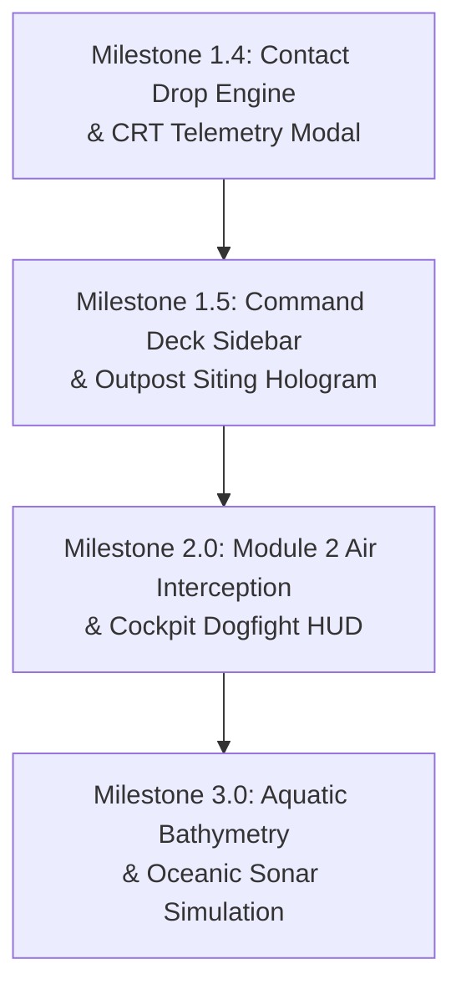

# Architectural Blueprint: Accommodating the Classic X-COM Experience in the Geoscape

> [!NOTE]
> **Context:** This blueprint reviews the original reference material in [`references/`](../../references/) (spanning Amiga CD32, DOS VGA, PlayStation 1, and Windows 95 releases of *UFO: Enemy Unknown / UFO Defense* [1994] and *X-COM: Terror from the Deep* [1995]) and details how to faithfully translate the classic Geoscape aesthetic and gameplay loop into **Project Vigilance** for RimWorld 1.7 (Waylith) on .NET 10.
> **Interactive Mockup:** A fully functional HTML5/Canvas/WebAudio interactive art prototype is preserved at [`Mockups/geoscape_command_deck_mockup.html`](Mockups/geoscape_command_deck_mockup.html).

---

## 1. Executive Summary: Deconstructing the "Classic X-COM Feel"

The classic X-COM Geoscape is fundamentally a **diegetic command bunker experience** driven by three intertwined psychological layers:

```
                  ┌───────────────────────────────────────────────┐
                  │           THE COMMAND BUNKER DIEGESIS         │
                  │  (Bevelled Consoles, CRT Telemetry, Gimbal)   │
                  └───────────────────────┬───────────────────────┘
                                          │
                                          ▼
                  ┌───────────────────────────────────────────────┐
                  │       TEMPORAL PACING & TENSION ENGINE        │
                  │   (Discrete Fast-Forwarding & Contact Drop)   │
                  └───────────────────────┬───────────────────────┘
                                          │
                                          ▼
                  ┌───────────────────────────────────────────────┐
                  │           THE LIVING PLANETARY ARENA          │
                  │  (Cosmic Nebula, Day/Night, Bathymetry, Borders│
                  └───────────────────────────────────────────────┘
```

1. **Diegetic Command Deck Interface:** Heavy bevelled frames, monospace dot-leader telemetry (`SIZE...VERY SMALL`, `SPEED...1480`), running digital mission clocks, and tactile 3D trackball navigation.
2. **Temporal Pacing & The "Contact Drop":** Long stretches of strategic time compression leaping between discrete intervals, punctuated by the heart-stopping **Contact Drop**—the sudden, automatic deceleration of the universe to tactical speed (`5 Secs` or Pause) the instant a bogey enters the radar envelope.
3. **The Living Planetary Arena:** A dark, foreboding cosmic void with atmospheric nebulas (violet interstellar clouds for UFO Defense; apocalyptic crimson for TFTD), sharp day/night terminators, sovereign geopolitical borders with marked capitals, and deep multi-tiered bathymetric ocean depths for aquatic submarine warfare.

---

## 2. Reference Material Visual & Mechanical Audit

Audit of the 10 reference files in [`references/`](../../references/):

| Reference Asset | Platform & Game | Core Visual & Mechanical Elements |
| :--- | :--- | :--- |
| [`16068943`](../../references/16068943-x-com-ufo-defense-amiga-cd32-i-just-built-my-first-base.png) | Amiga CD32 (*UFO Defense*) | Deep violet nebula background with cross-flair stars; sharp day/night terminator; newly established base shown as cyan square with center dot; right-hand sidebar with 6 command buttons (`INTERCEPT`, `BASES`, `GRAPHS`, `UFOPAEDIA`, `OPTIONS`, `FUNDING`); digital LED clock with running seconds (`12:00:15 FRIDAY 1st Jan 1999`); 6 discrete time compression buttons; rotating trackball gimbal with cardinal arrows and dual zoom cutaway buttons. |
| [`16667984`](../../references/16667984-x-com-terror-from-the-deep-playstation-selecting-the-site-for-yo.png) | PlayStation 1 (*TFTD*) | Top banner overlay: `SELECT SITE FOR NEW BASE` in green monospace font with double-bevel silver frame; fiery reddish-amber cosmic nebula; **multi-tiered bathymetric oceans** with distinct continental shelf shallows, slope, and abyssal rifts; clock reads `2040`. |
| [`16804431`](../../references/16804431-x-com-ufo-defense-playstation-the-game-has-you-monitoring-the-ea.png) | PlayStation 1 (*UFO Defense*) | Smooth atmospheric limb shading on planet rim; textured Antarctic sea-ice pack; yellow pointer hovering over `UFOPAEDIA`. |
| [`1889751`](../../references/1889751-x-com-ufo-defense-dos-tracking-an-ufo.png) | DOS VGA (*UFO Defense*) | **Geopolitical globe rendering:** White national border vectors and yellow landmark capital labels with red dots (`UK / London`, `SPAIN / Madrid`, `Casablanca`, `Cairo / EGYPT`, `Moscow`). Floating **Air Interception HUD:** Green CRT radar cone with interceptor, flanking missile hardpoint ammo indicators (`3` missiles remaining each), target blip, 4 stance buttons (Cautious, Standard, Aggressive, Disengage), craft status silhouette, and phosphor green range countdown (`560`). |
| [`1892896`](../../references/1892896-x-com-ufo-defense-amiga-build-first-base.png) & [`5457132`](../../references/5457132-x-com-ufo-defense-windows-world-map.jpg) | Amiga & Win95 (*UFO Defense*) | `SELECT SITE FOR NEW BASE` planetary survey mode with double-bevelled banner. Win95 version features metallic green border styling. |
| [`6336806`](../../references/6336806-x-com-terror-from-the-deep-dos-geoscape-view.png) | DOS VGA (*TFTD*) | Apocalyptic amber/crimson cosmos; bright solar illumination with sharp terminator into deep night; multi-depth ocean hexes. |
| [`9477245`](../../references/9477245-x-com-terror-from-the-deep-windows-alien-submarine-has-been-spot.jpg) | Win95 (*TFTD*) | **Diegetic Telemetry Alert:** Slate-teal modal box with double grey bevel; header `ALIEN SUB-1 Detected`; dot-leader telemetry (`SIZE...VERY SMALL`, `DEPTH...DEEP`, `HEADING...EAST`, `SPEED...1480`); prominent single-click action `[ CENTRE ON ALIEN SUB-TIME=5 Secs ]` and `[ CANCEL ]`. |

---

## 3. Core Architectural Proposals

### Proposal 1: The Diegetic Command Deck HUD & Vanilla UI Integration

To capture the retro command bunker feeling without colliding with RimWorld's vanilla interface:

```
┌────────────────────────────────────────────────────────────────────────────┬────────────────────────┐
│  [SELECT SITE / STATUS BANNER]                                             │ [ INTERCEPT ]          │
├────────────────────────────────────────────────────────────────────────────┤ [ BASES / OUTPOSTS ]   │
│                                                                            │ [ GRAPHS & TELEMETRY ] │
│                                                                            │ [ INTEL ARCHIVE ]      │
│                                                                            │ [ SENSORY FILTERS ]    │
│                                ( 3D GLOBE )                                │ [ FACTION RELATIONS ]  │
│                                                                            ├────────────────────────┤
│                                                                            │      1 4 : 2 2 : 0 8   │
│                                                                            │    12th Aprimay 5502   │
│                                                                            ├────────────┬───────────┤
│                                                                            │ [ 5 Secs ] │ [ 1 Min ] │
│                                                                            │ [ 5 Mins ] │ [30 Mins] │
│                                                                            │ [ 1 Hour ] │ [ 1 Day ] │
│   ┌──────────────────────────┐                                             ├────────────┴───────────┤
│   │ [LetterStack Cascades    │                                             │           ▲            │
│   │  to the left of Sidebar] │                                             │        ◄  ●  ►         │
│   └──────────────────────────┘                                             │           ▼            │
│                                                                            │      [ + ]   [ - ]     │
└────────────────────────────────────────────────────────────────────────────┴────────────────────────┘
```

#### Technical Harmonization with RimWorld UI:
1. **`LetterStack` Offset:**
   - In vanilla RimWorld, `LetterStack.LetterStackOnGUI` anchors the notification column along the right edge (`UI.screenWidth - 38f`).
   - *Harmony patch:* Offset the letter anchor by `-(SidebarWidth + 10f)` so letters cascade to the left of the command deck rather than rendering underneath it.
2. **`WorldGlobalControls` Synchronization:**
   - In vanilla, speed and date widgets render at the bottom-right.
   - *Harmony patch:* When the Classic HUD is toggled on in `GeoscapeSettings.cs`, suppress vanilla `WorldGlobalControls` to eliminate competing speed buttons and clocks.
3. **Tactical Trackball Gimbal:**
   - Smooth planetary rotation via cardinal controls calling `Find.WorldCameraDriver.altitude` and `Find.WorldCameraDriver.RotateTo(...)`.
   - Discrete zoom increments between strategic global view and tactical hex surveillance.

---

### Proposal 2: Discrete Time Compression & The "Contact Drop" Engine

The defining psychological thrill of classic X-COM is the transition from strategic fast-forwarding to the sudden, jarring **Contact Drop**.

#### 1. Speed Mapping:
- `5 Secs` $\rightarrow$ `TimeSpeed.Normal` (1x: 60 TPS, tactical pursuit & vector interception).
- `1 Min` $\rightarrow$ `TimeSpeed.Fast` (2x: 180 TPS, standard patrol tracking).
- `5 Mins` / `30 Mins` $\rightarrow$ `TimeSpeed.Superfast` (3x: 360 TPS, regional caravan transit).
- `1 Hour` / `1 Day` $\rightarrow$ `TimeSpeed.Ultrafast` (4x: 900 TPS, high-speed patrol simulation with auto-interrupt).

#### 2. The "Contact Drop" Interruption Hook:
In `EarlyWarningDispatcher.cs`:
```csharp
if (newTier >= IntelligenceTier.Contact && !incursion.HasDispatchedContactAlert)
{
    if (GeoscapeMod.Settings.enableContactDrop)
    {
        Find.TickManager.CurTimeSpeed = GeoscapeMod.Settings.contactDropToPause 
            ? TimeSpeed.Paused 
            : TimeSpeed.Normal;
        
        // Classic tactile radar ping audio cue
        PV_SoundDefOf.PV_TacticalRadarPing?.PlayOneShotOnCamera();
    }
    
    incursion.HasDispatchedContactAlert = true;
    DispatchContactLetter(incursion, sensor);
}
```

---

### Proposal 3: Retro CRT Telemetry Modal (`Dialog_ContactDetected`)

Directly replicating the Windows/DOS alert from [`9477245`](../../references/9477245-x-com-terror-from-the-deep-windows-alien-submarine-has-been-spot.jpg):

```
╔════════════════════════════════════════════════════════════════════════╗
║  TACTICAL SENSOR CONTACT: CONTACT-04                                   ║
║  Detected by Phased Array (Listening Post Delta)                       ║
║                                                                        ║
║  TARGET CLASSIFICATION.........AIRBORNE CARRIER / HEAVY TRANSPORT      ║
║  ESTIMATED THREAT..............TIER 2 (UNCONFIRMED CONTACT BLIP)       ║
║  ESTIMATED SIGNATURES..........MEDIUM (14-22 UNITS)                    ║
║  ALTITUDE / MEDIUM.............HIGH STRATOSPHERIC (32,000 FT)          ║
║  COMPASS HEADING...............SOUTHEAST (138°)                        ║
║  ESTIMATED GROUND SPEED........1,850 KTS (~24 HEXES/DAY)               ║
║  INTERSECTING SECTOR...........TILE #14820 (COLONY TERRITORY)          ║
║  PROJECTED ARRIVAL.............~16.4 HOURS                             ║
║                                                                        ║
║  [ CENTRE ON TARGET — TIME = 5 SECS ]                                  ║
║  [ SCRAMBLE INTERCEPTOR ]                    [ CLOSE & MONITOR ]       ║
╚════════════════════════════════════════════════════════════════════════╝
```

#### Key Capabilities:
- Single-click `[ CENTRE ON TARGET — TIME = 5 SECS ]` pans the camera, locks onto the incursion vector, and drops time to normal tactical speed.
- Monospace dot-leader telemetry (`.PadRight(28, '.')`).
- Configurable in settings: `Classic CRT Modal`, `Standard RimWorld Letters`, or `Both`.

---

### Proposal 4: Terror from the Deep (TFTD) Oceanic Bathymetry & Underwater USOs

Direct reference: [`16667984`](../../references/16667984-x-com-terror-from-the-deep-playstation-selecting-the-site-for-yo.png) and [`6336806`](../../references/6336806-x-com-terror-from-the-deep-dos-geoscape-view.png).

#### 1. Multi-Tier Bathymetric World Layer (`WorldDrawLayer_OceanDepth`):
Leverages RimWorld's existing negative elevation data (`tile.elevation < 0`):
- **Tier 1: Continental Shelves & Coastal Shallows (-1m to -1,000m):** Lighter cyan/turquoise stippled mesh. Standard sonar propagation; target easily sighted from air or sea.
- **Tier 2: Deep Oceanic Basins (-1,001m to -3,500m):** Deep navy cobalt. Medium acoustic attenuation.
- **Tier 3: Abyssal Trenches & Oceanic Rifts (-3,501m and below):** Midnight abyssal indigo/black. Severe acoustic distortion.

#### 2. Sonar Propagation in `CompRadar.cs`:
- Hydrophones propagate strictly over contiguous water hexes (`tile.WaterCovered`).
- Landmasses fully occlude sonar propagation.
- Submersible craft (USOs) entering deep ocean trenches dive to evade conventional ground radar (`"Contact Lost in Abyssal Trench"`), requiring coastal hydrophone arrays or acoustic buoys to maintain tracking.

---

### Proposal 5: Geopolitical Borders & Strategic Landmark City Labels

Direct reference: [`1889751`](../../references/1889751-x-com-ufo-defense-dos-tracking-an-ufo.png).

1. **Sovereign Border Vectors (`WorldDrawLayer_GeopoliticalBorders`):**
   - Compute territorial boundary edges radiating from faction settlements using BFS voronoi partitioning on `WorldGrid`.
   - Render crisp, semi-transparent white/grey vector outlines along border hex edges.
2. **Strategic Landmark Labels & Capital Pins:**
   - Display prominent yellow monospace callouts with red marker pins above major faction capitals and player listening posts.
   - At high camera altitudes, individual settlement icons fade into geopolitical territory names (e.g., `UNITED OUTLANDER FEDERATION`, `IMPERIAL DOMINION`).
3. **Synergy with Module 4 (Campaign & Panic):**
   - Incursions inside sovereign borders impact that specific faction's regional panic and alliance stability.

---

### Proposal 6: Interactive Outpost Siting Hologram ("Select Site for New Base")

Direct reference: [`1892896`](../../references/1892896-x-com-ufo-defense-amiga-build-first-base.png) and [`5457132`](../../references/5457132-x-com-ufo-defense-windows-world-map.jpg).

- Replaces raw right-click float menus on caravans with a dedicated survey mode:
  1. Activates full-screen planetary survey mode with top banner:  
     `SELECT SITE FOR AUTOMATED LISTENING POST [100 STEEL, 4 COMPONENTS]`
  2. Dynamically renders a **holographic preview dome**:
     - Projected outer detection ring ($R_{detect} = 12$ rings).
     - Dynamically calculates the topography vantage bonus from `SensoryTerrainUtility.GetVantageBonus(tile)` (+1 to +2 rings if hovering over hills or mountains).
     - Highlights sensor overlap and blind spots against existing colonies.
  3. Clicking confirms the destination, routing the caravan to travel to the site and automatically construct the station upon arrival.

---

### Proposal 7: Air Interception HUD Bridge (Module 1 to Module 2)

Direct reference: [`1889751`](../../references/1889751-x-com-ufo-defense-dos-tracking-an-ufo.png).

```
╔════════════════════════════════════════════════════════════════════════╗
║                      AERIAL INTERCEPTION TELEMETRY                     ║
╠═══════════════════════════════╦════════════════════════════════════════╣
║     [ CRT RADAR CONE ]        ║ [ ENGAGEMENT STANCE ]                  ║
║              ▲ (UFO Bogey)    ║   ( ) Cautious Standoff (Missiles)     ║
║              │                ║   (•) Standard Attack Profile          ║
║          [ 560 m ]            ║   ( ) Aggressive Dogfight (Close-In)   ║
║              │                ║   ( ) Disengage & Abort Mission        ║
║         ▼ (Interceptor)       ╠════════════════════════════════════════╣
║                               ║ [ WEAPON HARDPOINTS ]                  ║
║ [HARDPOINT 1]    [HARDPOINT 2]║  • Left Pod: Avalanche Missiles [3]    ║
║  Avalanche (3)    Avalanche (3)║  • Right Pod: Avalanche Missiles [3]   ║
║ Target: UFO Medium Scout      ║  • Nose: 30mm Vulcan Cannon [Ready]    ║
║ Craft: Interceptor Raven-1    ║ [ ENGAGE TARGET ]   [ WITHDRAW CRAFT ] ║
╚═══════════════════════════════╩════════════════════════════════════════╝
```

- When an interceptor craft reaches the target hex, the HUD opens the tactical dogfight console, calculating weapon salvos and crash site generation in real time.

---

### Proposal 8: Atmospheric Immersion & The Cosmic Void Presentation

Direct reference: [`16068943`](../../references/16068943-x-com-ufo-defense-amiga-cd32-i-just-built-my-first-base.png), [`16804431`](../../references/16804431-x-com-ufo-defense-playstation-the-game-has-you-monitoring-the-ea.png), [`6336806`](../../references/6336806-x-com-terror-from-the-deep-dos-geoscape-view.png).

1. **Procedural Cosmic Nebula Skybox:**
   - Shaders for `Classic Violet Nebula` (1994) and `Apocalyptic Crimson Abyss` (1995).
2. **Planetary Limb Glow (Atmospheric Rim):**
   - Fresnel atmospheric shader highlighting the perimeter of the sphere.
3. **Sharp Day/Night Terminator:**
   - Stark solar terminator with dark-side settlement luminescence.

---

## 4. Phased Implementation Roadmap



1. **Phase A (Milestone 1.4 Immediate): The Tension & Alert Engine**
   - Implement discrete Geoscape time controls and automatic "Contact Drop" to `Normal` (or Pause) upon radar detection in `EarlyWarningDispatcher.cs`.
   - Build `Dialog_ContactDetected` with monospace dot-leader telemetry and `[CENTRE ON TARGET — TIME=5 SECS]`.
2. **Phase B (Milestone 1.5): The Command Deck Sidebar & Outpost Siting Hologram**
   - Implement the right-side operations sidebar with live seconds LED mission clock and trackball gimbal.
   - Patch `LetterStack` and `WorldGlobalControls` for seamless coexistence.
   - Add interactive holographic preview dome for caravan listening post deployment.
3. **Phase C (Module 2: Interception): Air Dogfight Cockpit**
   - Implement the floating air interception CRT mini-console matching screenshot `1889751`.
4. **Phase D (Module: Aquatics / TFTD): Oceanic Bathymetry & Underwater USOs**
   - Add `WorldDrawLayer_OceanDepth` leveraging negative elevation tiles.
   - Implement sub-surface USO dive concealment and hydrophone array propagation.
