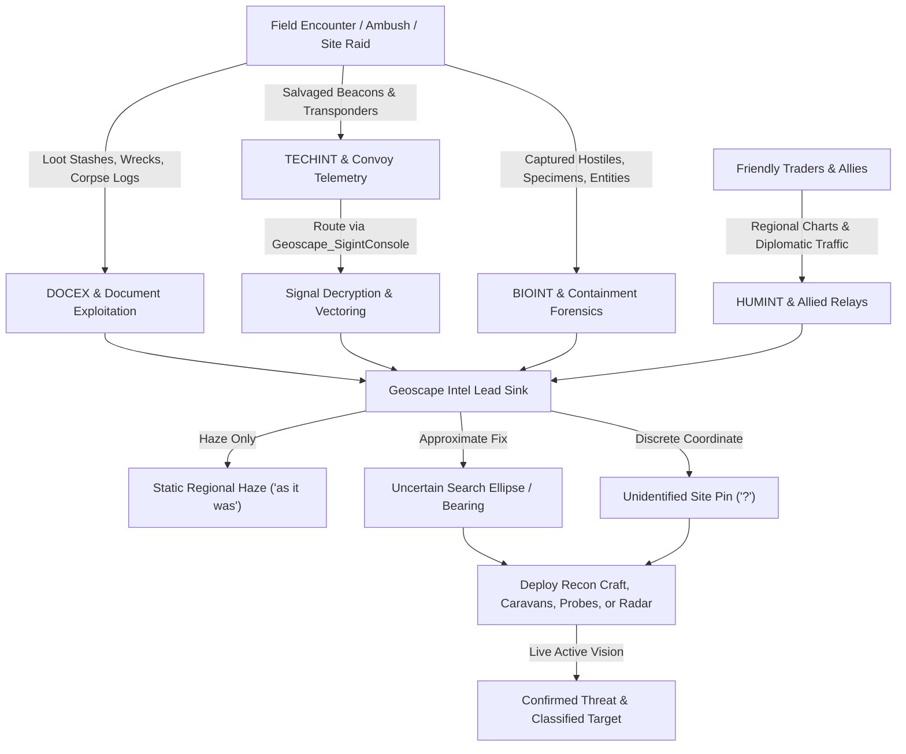

# Architectural Plan: All-Source Intelligence, Allied Relays & Exploration Mechanics

## Executive Summary & Design Pillars

This blueprint defines an investigative, cross-module intelligence and planetary exploration expansion spanning **Module 1 (Geoscape)**, **Module 2 (Interception & Rapid Response)**, and **Module 3 (Containment & Biology)**. Rather than lifting Fog of War cheaply on generic triggers, every non-sensor clue feeds an authentic X-COM intelligence cycle linking field encounters, containment forensics, signal decryption, and active aerial or ground reconnaissance.

### Core Epistemic & Balance Pillars

1. **Strict Separation Between Historical Intel and Live Sensor Feeds:**
   - **Non-sensor intelligence reveals only `Haze` (historical static geography), unidentified `?` site pins, or bounded search ellipses — never free live `Clear` vision.**
   - Live movement tracking (`Clear` vision and contact classification) remains exclusively the domain of active C4ISR assets: lookouts, listening posts, radar domes, coastal sonar, `Geoscape_SigintConsole` links, orbital passes, and recon craft.
   - Because evidence dates the moment it was created, `Haze` sectors uncovered via charts or salvaged logs tie directly into Milestone 1.9's **Explored Haze Staleness** timestamps (`Last Observed`) — showing the map "as it was", not magically live.

2. **Explicit Anti-Pattern: No Uncapped Caravan Sight-Stat Scaling:**
   - Scaling world-map fog reveal radius from colony/caravan pawn `Sight` stats (including bionic eyes, archotech implants, psycasts, or third-party race mods reaching `200%–500%` Sight) collapses strategic sensor progression by letting a single pawn emulate an industrial radar array.
   - `ScoutHorizonSensor` optical horizons remain strictly governed by base scout radius, terrain vantage (`Hilliness` / elevation bonuses), circadian alertness, and weather penalties, with at most an optional capped `+1` hex hardware optics bonus where appropriate.

3. **Loose Cross-Module Coupling (`GEMINI.md` Rule 12):**
   - Optional modules (`Battlescape`, `Interception`, `Containment & Biology`) must never hold hard compile-time assembly references to `ProjectVigilance.Geoscape`.
   - All intelligence leads emitted by tactical skirmishes, autopsies, interrogations, or flight tracks flow through lightweight contracts (`GeoscapeIntelLead` / `IIntelLeadSink`) registered in `ProjectVigilance.Core` via `VigilanceModuleManager` at `[StaticConstructorOnStartup]`.
   - Third-party vehicles and craft integrate via declarative XML `DefModExtension_Sensor` definitions without custom C# dependencies.

> [!IMPORTANT]
> **Balance Invariant:** Evidence tells the player **where to investigate**; active sensors tell the player **what is happening right now**. No intel item, prisoner interrogation, autopsy, or diplomatic pact bypasses the need for radars, lookouts, or reconnaissance craft to maintain live situational awareness.

---

## Feature Area 1 — Drop-Zone Biome Filter for Blind Landings (Milestone 1.6)

### Current Baseline (`StartingSiteFeedbackUtility`)

Under `VisibilityMode.FogOfWar`, `StartingSiteFeedbackUtility` already prevents "sonar probing" across unrevealed sectors by masking terrain rejection messages (oceans, impassable mountains) with uniform ambiguous telemetry (`Unviable landing coordinates: Selected sector cannot support a colony drop.`) and suppressing pre-drop biome hazard confirmations. Players opting for blind drops receive a genuinely unknown starting hex.

### Planned Enhancement: Optional Biome Whitelist Filter

To improve early-campaign playability on blind runs without sacrificing spatial uncertainty:

- **Blind Random Drop Filter:** Players selecting a random hidden drop site in `FogOfWar` mode can specify an optional **Drop-Zone Biome Whitelist** (e.g. permitting Temperate Forest, Boreal Forest, and Arid Shrubland while excluding Sea Ice or Extreme Desert).
- **Strict Fog Preservation:** Filtering occurs strictly during candidate-tile selection before landing. Exact tile coordinates, neighbouring biomes, road/river junctions, world elevation, map previews, and nearby settlements remain hidden inside unrevealed Shroud until touchdown.
- **Settings & Localisation:** Exposed via a runtime toggle in `GeoscapeSettings` (`PV_Settings_*` keyed British English entries) and cleanly bypassed in `PlanetarySurveillance` and `Omniscient` modes.

---

## Feature Area 2 — Tiered Allied Shared Vision & Early-Warning Relays (Milestone 1.9)

Unconditional full-globe ally vision short-circuits frontier exploration and diminishes the strategic value of outpost networks. Diplomatic intelligence is therefore structured across three earned tiers tied to goodwill and base communications infrastructure:

| Diplomatic Tier                              | Requirement                                                                                | Shared Geoscape Picture                                                                                                                | Tech-Tiered Narrative Delivery                                                                             |
| :------------------------------------------- | :----------------------------------------------------------------------------------------- | :------------------------------------------------------------------------------------------------------------------------------------- | :--------------------------------------------------------------------------------------------------------- |
| **Tier 1: Friendly Rumours**                 | Goodwill `>= +50` (existing `BreadcrumbRumourUtility`)                                     | Compass direction, hex distance, and static pin for dynamic sites passed along trader routes                                           | Traveller anecdotes reported on arrival                                                                    |
| **Tier 2: Allied Cartography & Raid Relays** | Goodwill `>= +75` **and** powered colony `CommsConsole`                                    | Static `Haze` memory revealed over allied settlements plus forwarded early-warning alerts when hostiles cross allied sensor perimeters | **Pre-Industrial:** Delayed rider dispatches (`6–18h` lag). **Industrial+:** Radio/telemetry relay packets |
| **Tier 3: Spacer Allied Data-Link**          | Allied (`>= +75`), mutual Spacer/Ultra tech, dedicated Comms + Phased Array uplink channel | Optional live `Clear` perimeter feed shared within allied settlement radar bubbles                                                     | Encrypted digital data-link independently toggled per faction                                              |

### Failure Modes & Sabotage Synergy

- Loss of colony power, destruction of the `CommsConsole`, or hostile comms-sabotage/jamming bubbles immediately suspend Tier 2 relays and Tier 3 data-links cleanly via an $O(1)$ readiness check.
- If an allied settlement is overrun or abandoned off-screen while no friendly sensor holds live `Clear` vision, the settlement remains in stale `Haze` memory until an expedition or radar sweep verifies its fate.

---

## Feature Area 3 — All-Source Intelligence Loop (Milestone 1.9 & Phase 5)

Rather than isolated "use item to uncover fog" actions, field discoveries drive an investigative loop uniting ground tactical maps, containment laboratories, decryption consoles, and Geoscape reconnaissance.



### Four Intelligence Disciplines

| Discipline                                            | Primary Acquisition Paths                                                                                                           | Target Threat Categories                                                                                        | Geoscape Lead Output (Zero Free Live `Clear`)                                                                                           |
| :---------------------------------------------------- | :---------------------------------------------------------------------------------------------------------------------------------- | :-------------------------------------------------------------------------------------------------------------- | :-------------------------------------------------------------------------------------------------------------------------------------- |
| **HUMINT** _(Human & Social)_                         | Tradeable **Regional Charts**; expanding `BreadcrumbRumourUtility` reliability grades; prisoner persuasion/interrogation            | Raider camps, pirate towns, rival caravans, NPC staging hubs                                                    | Regional Charts uncover `8–12` hexes strictly in static `Haze`; interrogations add `?` origin/staging pins or expected ambush corridors |
| **DOCEX** _(Document & Site Exploitation)_            | Searching raided encampment containers/caches; commander corpse field orders; hacked terminal drives; downed craft flight recorders | Linked supply depots, forward listening posts, pirate redoubts, scheduled raid assembly points                  | Discrete `?` coordinates for downstream linked sites, rough patrol paths, or confidence upgrades in `[ INTEL ARCHIVE ]`                 |
| **TECHINT** _(Electronic Salvage)_                    | Recovering encrypted IFF transponders, frequency hopping keys, and black-box beacons from ambushed convoys or mechanoid wrecks      | Mechanoid clusters, jamming relays, orbital uplink relays, stealth approach vectors                             | Consumed at a powered `Geoscape_SigintConsole` to strip clutter, narrow search ellipses, or forecast inbound incursion trajectories     |
| **BIOINT** _(Biology & Anomaly Forensics — Module 3)_ | Surgical autopsies, Anomaly entity study benches, spore/scent/pheromone sampling, and mental-resistance interrogations              | **Sentient animal packs/lairs, insectoid/biological mega-hives, Anomaly loci, aliens, and human-alien hybrids** | Triangulates nest/lair/loci search rings (`AddSearchEllipse`), pheromone trail vectors, or `?` hive pins across uncharted terrain       |

### Non-Human & Anomalous Intelligence Focus (`Module 3` Synergy)

Traditional prisoner interrogation breaks down when confronting non-humanoid or anomalous threats. `Module 3 (Containment & Biology)` broadens investigative sources so every faction archetype participates in Geoscape discovery:

- **Sentient Animals & Pack Alpha Lairs:** Tissue/gut-content forensics, neural tag recovery, or study reveals migratory grazing ranges (`Search Ellipse`) or alpha den hexes hidden behind mountain masking or deep wilderness Shroud.
- **Insectoid & Biological Hives:** Queen pheromone glands and chitin isotope signatures recovered from subterranean skirmishes narrow underground swarm infestation foci.
- **Anomaly Entities & Cultists:** Monolith resonance shards, bioferrite residue, and captured cultist codices pinpoint hidden psychic/anomaly loci suppressing coastal sonar or warping compass bearings.
- **Aliens & Human/Hybrid Collaborators:** Deep-interrogation of infiltrated human sympathisers, hybrids, or captured extraterrestrials reveals sleeper cells, infiltration supply chains, and secret landing beacons (feeding directly into Milestone 1.9 `[ INTEL ARCHIVE ]` dossier correlation).

### Cross-Module Soft Contract Specification

To preserve modular independence (`GEMINI.md` Rule 12), `ProjectVigilance.Core` exposes a pure-C# data contract implemented optionally by `Geoscape`:

```csharp
public enum IntelLeadKind
{
    RevealHazeArea,       // Uncovers static Haze only (Regional Charts, expedition logs)
    PinUnidentifiedSite,  // Places '?' marker without granting surrounding vision
    AddSearchEllipse,     // Draws probabilistic bearing/uncertainty ring (BIOINT / TECHINT)
    ForwardAlliedAlert    // Relays delayed allied threat notification
}

public readonly record struct GeoscapeIntelLead(
    IntelLeadKind Kind,
    PlanetTile TargetTile,
    int RadiusInTiles,
    float Confidence,       // 0.0..1.0 calibrated for Signal Confidence & Archive UI
    string SourceTag,       // Localisation key identifying origin discipline (HUMINT/DOCEX/TECHINT/BIOINT)
    int ExpiryTicks);       // Optional staleness / validity window
```

- When **Module 1 (`Geoscape`)** is absent, Modules 2 and 3 still execute autopsies, salvage, and raids normally (rewarding research unlocks and story lore) because `VigilanceModuleManager.TryPublishIntelLead(...)` cleanly no-ops if no `IIntelLeadSink` is registered.
- When **Module 1 (`Geoscape`)** is loaded, `SensoryManager` registers as `IIntelLeadSink`, translates leads into Shroud Hierarchy `StateHaze` transitions or `[ INTEL ARCHIVE ]` search overlays, and emits public static C# events for modders.

---

## Feature Area 4 — Aerial Recon Sweeps & External Craft Hooks (Phase 4 — Module 2)

Strategic exploration across vast oceans, mountains, and deep Shroud aligns naturally with X-COM's airborne interceptor and dropship layer rather than inflating pawn walking radius:

- **Organic Aerial Reconnaissance:** Deployed interceptors, Skyranger-class dropships, and amphibious craft project an altitude-governed sensor footprint (`Haze` + temporary live `Clear` corridor along the active flight vector), constrained realistically by aviation fuel burn, airframe sensor payload, and adverse weather/solar disruption.
- **Hostile Airspace Risk:** Flying unescorted recon sorties into uncharted regions exposes craft to hidden SAM/ASAT denial zones and radar-masked interception engagements.
- **Turnkey Third-Party Craft Integration:** Optional XML `PatchOperationFindMod` bundles attach `DefModExtension_Sensor` profiles to _Odyssey_ gravships/shuttles and _Vehicles Framework_ aircraft/ground vehicles, giving vehicle owners balanced corridor scouting without brittle C# assembly coupling.

---

## Compliance & Governance Checklist (`GEMINI.md`)

- **Rule 7 ($O(1)$ Tick & Zero Alloc):** Allied early-warning forwarding piggybacks on `SensoryManager`'s existing `SweepIntervalTicks` (`250` ticks) pass; search ellipses and stale Haze timestamps add zero per-tick LINQ allocations.
- **Rule 8 (Keyed Localisation):** All new intelligence letters, chart item tooltips, archive tags, and settings labels must use `"PV_*"` keys in `Languages/English/Keyed/*.xml` with British English (`en-GB`) spelling.
- **Rule 9 (Mod Settings Gating):** Expose independent runtime toggles in `GeoscapeSettings` (`enableAlliedIntelRelays`, `enableFieldDocExLeads`, `enableBlindBiomeFilter`, `alliedIntelMinGoodwill`).
- **Rule 10 (Extensibility):** Emit public static C# lifecycle delegates (`OnIntelLeadPublished`, `OnRegionalChartConsumed`) and expose XML `DefModExtension` fields (`hazeRevealRadius`, `intelDisciplineTag`) for modders.
- **Rule 11 (Accessibility & Colour):** Search ellipses, bearing cones, and allied warning blips inherit active `SensoryTheme` colourblind-safe palettes and pair silhouette/dashed geometry with WCAG AA contrast (`> 4.5:1`).
- **Rule 12 (Loose Coupling):** Strictly Core interface contracts + `[StaticConstructorOnStartup]` registration + conditional XML patches (`PatchOperationFindMod`).

---

## Milestone Rollout Mapping

| Target Stage in `TODO.md`                        | Deliverable                                                                                                                                                                           | Owning Module                                      |
| :----------------------------------------------- | :------------------------------------------------------------------------------------------------------------------------------------------------------------------------------------ | :------------------------------------------------- |
| **Milestone 1.6** _(Planetary Expedition)_       | Blind Landing Drop-Zone Biome Filter                                                                                                                                                  | `Geoscape`                                         |
| **Milestone 1.9** _(Imperfect Intelligence)_     | Tiered Allied Shared Vision & Relays; Regional Charts (`Haze`-only); DOCEX Stash/Corpse/Wreck Leads; TECHINT via `Geoscape_SigintConsole`; Search Ellipses & `GeoscapeIntelLead` Sink | `Core` + `Geoscape`                                |
| **Phase 4 — Module 2** _(Interception & Craft)_  | Airborne Recon Corridors (Interceptors/Dropships) & XML `DefModExtension_Sensor` Patches for Odyssey/Vehicles                                                                         | `Core` + `Interception` + `Geoscape` _(soft hook)_ |
| **Phase 5 — Module 3** _(Containment & Biology)_ | BIOINT Forensic Triangulation across Aliens, Hybrids, Sentient Animal Lairs, Insectoid Hives & Anomaly Loci                                                                           | `Core` + `Containment` + `Geoscape` _(soft hook)_  |
