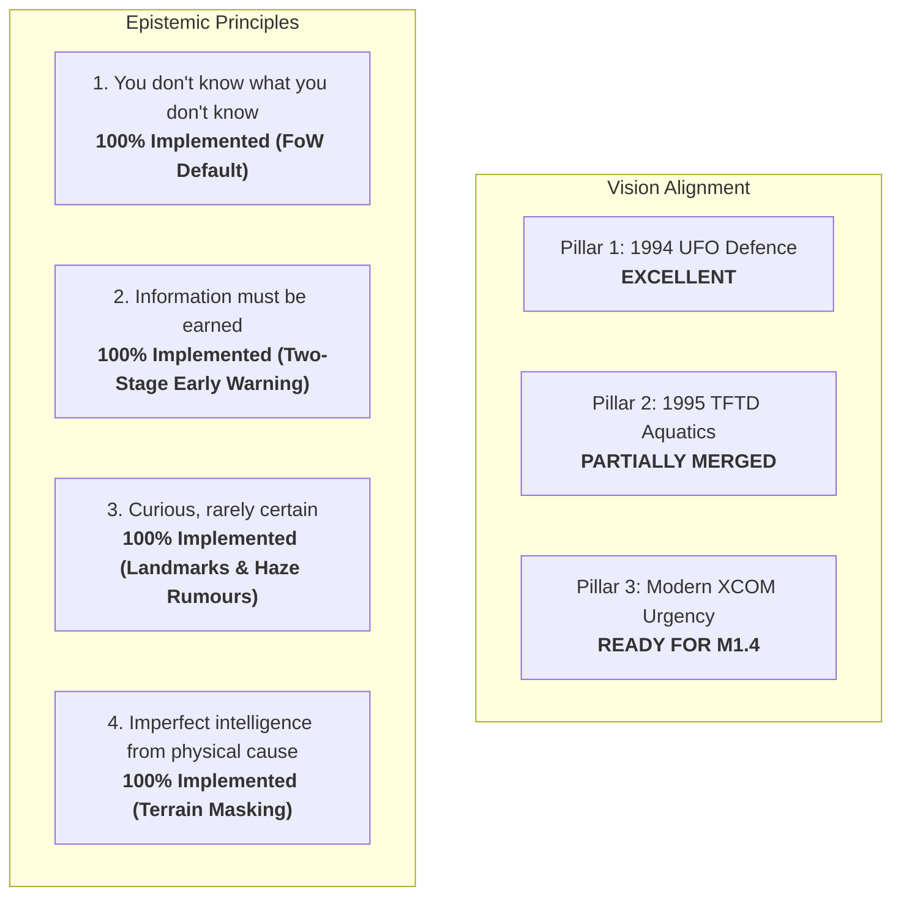
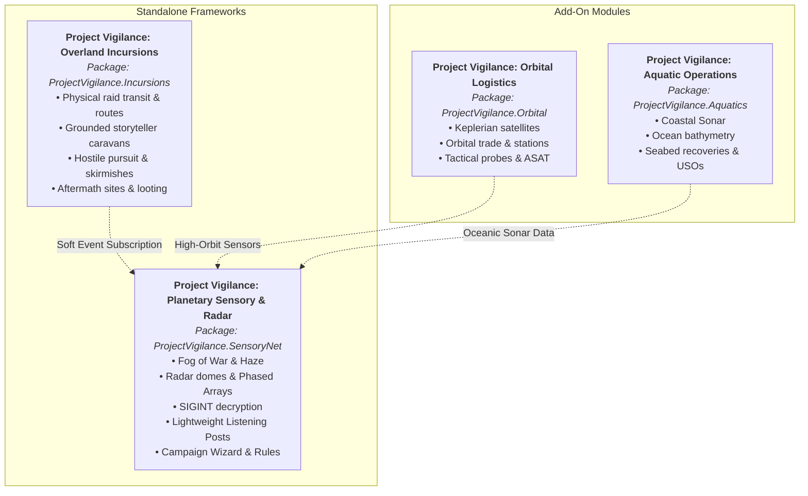

# Architectural Review & Modular Separation Plan: Project Vigilance

## Executive Summary

This review evaluates **Project Vigilance** in its current Milestone 1.3 state against its founding vision ([docs/architecture/vision-and-pillars.md](vision-and-pillars.md)) and modular architecture guidelines ([docs/architecture/modular-system.md](modular-system.md)).

As Milestone 1.3 concludes, the single mod package `ProjectVigilance.Geoscape` encompasses four distinct operational domains:

1. **Overland Incursions:** Physical raid transit, grounded storyteller events, post-retreat pursuit, background skirmishes, aftermaths.
2. **Sensory & Fog of War:** Planetary Fog of War, 3D holographic overlays, radar interferometry, lightweight outposts, epistemic intelligence.
3. **Orbital Ecosystem:** Analytical Keplerian mechanics, drifting trade satellites, orbital stations, dual-layer Surface/Orbit rendering.
4. **Aquatic Operations (Coastal Sonar):** Directional connected-water acoustic propagation and coastal station placement.

This document analyses whether, when, and how these systems should be separated into independent RimWorld mods on the Steam Workshop.

---

## 1. Vision & Guidelines Compliance Audit



### Detailed Pillar Evaluation

| Pillar / Principle                      | Vision Requirement                                                                      | Current Implementation in M1.3                                                                                 |                         Verdict                          |
| :-------------------------------------- | :-------------------------------------------------------------------------------------- | :------------------------------------------------------------------------------------------------------------- | :------------------------------------------------------: |
| **Pillar 1: 1994 UFO Defence**          | Planetary sensory sphere, radar bubbles, multi-outpost networks, moving world contacts. | 3D holographic mesh, Phased Arrays, SIGINT console, unmanned Listening Posts, grounded physical incursions.    |                    **100% Compliant**                    |
| **Pillar 2: 1995 Terror from the Deep** | Oceanic activation, coastal sonar, underwater USOs, seabed recoveries.                  | Directional connected-water BFS sonar implemented, but gated behind DevMode. Deep oceans remain untraversable. | **Scope Infiltration** (Belongs in `Vigilance.Aquatics`) |
| **Pillar 3: Modern Firaxis XCOM**       | Doom clock, extraction urgency, high stakes.                                            | Pacing ledgers and escalation rules exist; scheduled for Milestone 1.4+ (dropships, doom clock).               |                       **On Track**                       |
| **Standalone Framework Rule 1**         | Zero thematic hardcoding in frameworks (no alien lore in base).                         | Completely era-agnostic. Operates with tribals, medieval, outlanders, pirates, mechanoids.                     |                    **100% Compliant**                    |
| **Standalone Framework Rule 2**         | Contract-driven APIs & soft dependencies.                                               | Uses `ISensorProvider`, `IOrbitalEntity`, `IDetectableTarget`. Zero hard inter-suite locks.                    |                    **100% Compliant**                    |
| **Standalone Framework Rule 3**         | Isolated packaging & distribution.                                                      | Currently shipped as a single monolithic package: `ProjectVigilance.Geoscape`.                                 |               **Needs Strategic Decision**               |

---

## 2. Mod Separation Analysis

### The Current Package Monolith (`ProjectVigilance.Geoscape`)

Currently, `Geoscape/` is 152 source files spanning 4 distinct gameplay themes:

```text
Geoscape/
├── World/       --> Overland Incursions, grounded ambushes, pursuit, aftermaths (68 files)
├── Sensory/     --> Radar, Fog of War, listening posts, Model B+ vantage (42 files)
├── Orbital/     --> Keplerian orbits, trade satellites, orbital stations (18 files)
├── Rules/       --> Campaign creation wizard, mutability, HMAC ledger (14 files)
└── UI/          --> CRT HUD radar scope, overlays, colour palettes (10 files)
```

### Architectural Tension: Why Separation Is Being Considered

1. **Player Audience Divergence:**
   - **Audience A ("Logistics & Realism"):** Wants grounded physical raids and caravans walking across the globe instead of instant edge raids. Does _not_ want Fog of War or complex radar grids.
   - **Audience B ("Fog of War / 4X"):** Wants an uncharted planet with radar, outposts, and exploration shroud.
   - **Audience C ("Space / Sci-Fi"):** Wants orbital satellites and space stations (compatible with SOS2 / Odyssey DLC).
2. **Gated Features Clutter:**
   - Sonar arrays and military/recon satellites had to be gated behind DevMode in M1.3 because they outgrew the core "Overland Incursions" theme.
3. **Steam Workshop Discoverability:**
   - Mod is currently titled _"Project Vigilance: Overland Incursions"_, but contains an entire planetary radar network, satellite constellations, and campaign creation wizard.

---

## 3. Separation Models & Trade-Offs

### Model 1: The Monolithic Suite (Status Quo)

_Keep all systems in `ProjectVigilance.Geoscape`._

- **Pros:**
  - Zero inter-mod version mismatch.
  - Single Steam Workshop item to update (#3822378226).
  - Tightly integrated features (e.g. Incursions directly feed into Radar stage-alert escalation).
- **Cons:**
  - High configuration complexity (requires players to disable features via 5-tab ModSettings).
  - Bloats install size for players wanting only raid transit.
  - Dilutes the mod's Workshop branding.

---

### Model 2: Clean Two-Framework Split (Recommended Milestone 1.4 Target)

_Split into two dedicated standalone frameworks + one expansion layer:_



#### Contract Boundary Between M1 and M2:

- If `SensoryNet` is absent: Incursions move across the globe and appear with standard vanilla visibility.
- If `SensoryNet` is present: Incursions are shrouded by Fog of War and trigger two-stage early warning alerts upon crossing radar perimeters.
- Handshake mechanism: `ISensorProvider` and `IDetectableTarget` contracts (already implemented in `Geoscape/Source/Geoscape/Sensory/ISensorProvider.cs`).

---

## 4. Recommended Strategic Roadmap

### Phase 1: Milestone 1.3 Release (Current State)

- **Action:** **Do NOT separate now.**
- **Rationale:** Milestone 1.3 is 100% verified (424 tests passing) and ready for playtesting. Splitting packages now would destabilise tested systems and delay delivery.
- **Hygiene Action:** Maintain strict internal namespace separation (`.World`, `.Sensory`, `.Orbital`, `.Rules`). Keep Sonar and non-standard satellites gated to DevMode.

### Phase 2: Milestone 1.4 (Aquatics Extraction)

- **Action:** Move Coastal Sonar (`SonarTraversalUtility`, `PlaceWorker_CoastalSonar`, `Geoscape_SonarArray`, `Vigilance_ListeningPost_Sonar`) out of Geoscape into its designated standalone module: **`Vigilance.Aquatics`**.
- **Result:** Keeps Geoscape clean of premature maritime mechanics until oceanic bathymetry is ready.

### Phase 3: Milestone 1.6 (Orbital Extraction Evaluation)

- **Action:** When implementing the [Tactical Orbital Warfare Plan](tactical_orbital_warfare_plan.md) (tactical expendable probes, ground uplink capacity, ASAT silos), evaluate spinning off **`Vigilance.Orbital`** as an independent expansion or co-packaged module with Odyssey DLC synergy.

---

## Decision Recorded & Approved

- **Milestone 1.3 Scope:** Keep unified package (`ProjectVigilance.Geoscape`) for release. All 424 verified unit tests and features remain intact.
- **Sonar Extraction:** Coastal Sonar (`SonarTraversalUtility`, `PlaceWorker_CoastalSonar`, `Geoscape_SonarArray`, `Vigilance_ListeningPost_Sonar`) remains gated behind `Prefs.DevMode` in Milestone 1.3 and will be extracted into the standalone **`Vigilance.Aquatics`** module in Milestone 1.4 or later.
- **Orbital Evaluation:** Re-evaluate standalone `Vigilance.Orbital` module during Milestone 1.6 along with the Tactical Orbital Warfare implementation.
