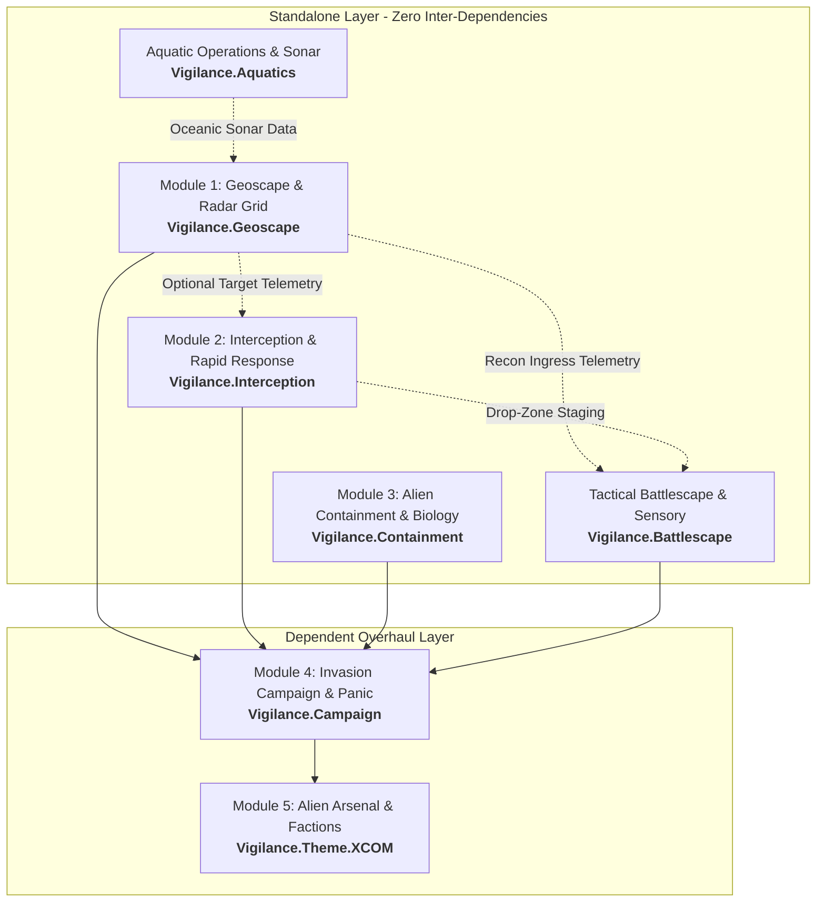

# Modular System Architecture

## 1. Overview

To ensure maintainability, rapid iteration, and wide community adoption, the project is structured as a **suite of decoupled add-ons**.

Instead of a single monolithic mod that risks breaking with game updates or conflicting with other popular overhauls, each module has clearly defined boundaries. Several modules function as **standalone utilities** that benefit the wider RimWorld modding ecosystem even outside of an X-COM context.

---

## 2. Standalone vs. Dependent Classification

Every module in the suite is strictly classified as either **Standalone** (zero dependencies on other Vigilance mods) or **Dependent** (part of the overarching campaign layer):

| Module                                      | Identifier               | Classification | Suite Dependencies          | Standalone Use Case                                                                                                                              |
| :------------------------------------------ | :----------------------- | :------------: | :-------------------------- | :----------------------------------------------------------------------------------------------------------------------------------------------- |
| **Module 1: Geoscape & Radar Grid**         | `Vigilance.Geoscape`     | **STANDALONE** | **None**                    | Planetary fog of war, early-warning radar domes, satellite listening posts, tracking any airborne/orbital vectors (pirate shuttles, mechanoids). |
| **Module 2: Interception & Rapid Response** | `Vigilance.Interception` | **STANDALONE** | **None** _(Soft-dep on M1)_ | Air combat scrambles, aerial dogfights against incoming raids, rapid transport drops, and tactical extraction beacons.                           |
| **Module 3: Alien Containment & Biology**   | `Vigilance.Containment`  | **STANDALONE** | **None**                    | Stasis pods, live prisoner interrogation, surgical autopsies, and tech reverse-engineering for _any_ mod or faction.                             |
| **Aquatic Operations (TftD Layer)**         | `Vigilance.Aquatics`     | **STANDALONE** | **None** _(Hooks M1/M2)_    | Activates deep ocean tiles, coastal sonar arrays, seabed shipwreck recoveries, and diving gear for maritime playthroughs.                        |
| **Tactical Battlescape & Sensory**          | `Vigilance.Battlescape`  | **STANDALONE** | **None** _(Hooks M1/M2)_    | 3-mode tactical fog of war, vision cones, acoustic/scent tracking for pawns/pets/mechs, and guerrilla pod AI.                                    |
| **Module 4: Invasion Campaign & Panic**     | `Vigilance.Campaign`     | **DEPENDENT**  | Modules 1, 2, 3             | The geopolitical doom clock, Council funding, regional panic meters, and alien strategic invasion AI.                                            |
| **Module 5: Alien Arsenal & Factions**      | `Vigilance.Theme.XCOM`   | **DEPENDENT**  | Module 4                    | Authentic X-Com alien races, plasma/sonic weapons, carapace/titan armours, and franchise audio/visual FX.                                        |

---

## 3. Core Standalone Engineering Principles

To guarantee that standalone modules remain truly independent, all code must adhere to three non-negotiable architectural rules:

### Rule 1: Zero Thematic Hardcoding in Frameworks

Framework modules (Modules 1, 2, 3, and Aquatics) **must never reference X-COM lore, alien race names, or campaign logic**.

- _Module 1 (Radar)_ tracks generic `WorldObject_MovingCraft` targets via XML `ModExtension` or `DetectionProfileDef`. A pirate gunship, mechanoid dropship, or custom faction transport can be tracked just as easily as a UFO.
- _Module 3 (Containment)_ exposes generic `CompProperties_Containment` and `RecipeDef_Autopsy` bills. Players can use it to contain and study vanilla mechanoids, mutated prisoners, or Anomaly entities without any alien content.

### Rule 2: Contract-Driven APIs & Soft Dependencies

Where modules integrate, they must do so via **loose coupling and dynamic event hooks**:

- Module 2 (Interception) operates out-of-the-box using manual scramble orders and vanilla quest locations. If Module 1 (Radar) is detected in the mod list, it automatically subscribes to radar vector alerts.
- Module 3 (Containment) checks dynamically for the **Anomaly DLC**: if active, it binds to native entity study platforms; if absent, it executes its standalone holding-pod logic.

### Rule 3: Isolated Packaging & Distribution

Each standalone module has its own independent Steam Workshop / GitHub release pipeline:

- Distinct `packageId` and self-contained `About.xml`.
- No shared monolithic assemblies; each module distributes its own clean `.dll`.
- Independent settings menus allowing players to tune features without the wider suite.

### Rule 4: Decoupled Internal Namespaces for Future Extraction

To avoid premature package fragmentation while ensuring architectural agility, subsystems within `ProjectVigilance.Geoscape` are segregated into dedicated namespaces with contract boundaries:

- `ProjectVigilance.Geoscape.World`: Core incursion movement, staging resolution, arrival handling.
- `ProjectVigilance.Geoscape.Sensory`: Sensory radar components, spatial bitmask fog of war, scout horizons, and contact managers (bound via `ISensorProvider`).
- `ProjectVigilance.Geoscape.Tactical`: Global hex interception, forward ambush generation, and retreat/pursuit.

If community adoption warrants extracting `ProjectVigilance.SensorNet` as an independent Workshop upload, the separation requires zero core refactoring.

---

## 4. Dependency Matrix

---

## 5. Module Breakdown

### Module 1: Geoscape & Radar Grid (`Rimworld-Geoscape`)

- **Role:** Planetary sensory framework.
- **Standalone Utility:** High. Any mod requiring radar, early warning systems, planetary fog of war, or hidden world locations can use this without any alien content.
- **Core Systems:**
  - `WorldObjectComp_Radar`: Attached to settlements or standalone world objects (listening posts, satellites).
  - Planetary sensory bubbles: Calculates detection range on the `WorldGrid`.
  - Detection probability algorithms based on craft altitude, size, and stealth signatures.
  - Hidden world objects / dynamic moving targets (`WorldObject_Incursion` / `WorldObject_MovingCraft`).
  - Aquatic sonar support for oceanic tiles (Terror from the Deep layer).

### Module 2: Interception & Rapid Response (`Rimworld-Interception`)

- **Role:** Aerial and orbital interception, long-range transport deployment.
- **Dependencies:** Soft dependency on Module 1 (for target vectors).
- **Standalone Utility:** Medium-High. Can be used for general military air-defence and rapid deployment.
- **Core Systems:**
  - Craft range, fuel consumption, speed, and armament loadouts.
  - Interception combat resolution (simulated tactical engagement dialogue or automated resolution).
  - Downed / crash-site generator (spawning temporary `SiteDef` instances with salvageable wreckage).
  - Deployment and extraction drop-zones for tactical response teams.

### Module 3: Alien Containment & Biology (`Rimworld-Containment`)

- **Role:** Live entity capture, alien autopsies, and reverse-engineering.
- **Dependencies:** None (Fully standalone).
- **Standalone Utility:** High. Expands medical research and prisoner interactions for any sci-fi or creature mod.
- **Core Systems:**
  - Stasis holding pods and secure containment cells.
  - Interrogation bills and alien autopsy work tables.
  - Knowledge discovery trees and reverse-engineering data points (synergises with vanilla 1.5 / Anomaly study mechanics if present, but functions independently).

### Tactical Battlescape & Sensory (`Rimworld-Battlescape`)

- **Role:** Local map tactical fog of war, asymmetric sensory modelling, and anti-killbox combat AI.
- **Dependencies:** None (Fully standalone; hooks into Module 1 and 2 if present).
- **Standalone Utility:** Very High. Brings authentic 3-tier Fog of War, directional vision cones, scent/acoustic tracking, and guerrilla fireteam AI to any RimWorld combat encounter.
- **Specification:** See [docs/modules/battlescape-and-tactical-combat.md](../modules/battlescape-and-tactical-combat.md).
- **Core Systems:**
  - 3-mode visibility: Classic Haze of War (3-tier FoW), Tactical Site Surveillance, and Omniscient.
  - Multi-tier sensory architecture: Optical cones (humans), scent/acoustic proximity (pets/war beasts), multi-spectral and phased radar (mechanoids).
  - Tactical equipment: Handheld Motion Scanners, weapon flashlights, flares, and smoke screens.
  - Guerrilla & Pod AI: Fireteam patrol cohesion, ambushes, fatal-funnel traps, suppressive peeling retreats, and perimeter wall breaching.
  - Zero-allocation spatial cell bitmasks on .NET 10 / Waylith engine.

### Module 4: The Invasion Campaign & Panic (`Rimworld-Campaign`)

- **Role:** The overarching strategic game loop, global doom clock, and geopolitics.
- **Dependencies:** Requires Module 1, Module 2, and Module 3.
- **Core Systems:**
  - Planetary faction funding and Council evaluations (monthly performance reviews).
  - Regional panic metrics per faction/territory.
  - Alien strategic AI: Schedules scouting runs, harvest waves, terror raids, and alien base construction.
  - Escalation clock ("Avatar-style" invasion progress counter) with counter-operations.

### Module 5: Alien Arsenal & Factions (`Rimworld-XCOM-Theme`)

- **Role:** Pure thematic content pack.
- **Dependencies:** Requires Module 4.
- **Core Systems:**
  - Faction definitions: Ethereal/Alien Invaders, Advent/Infiltrators, Deep Ones/Aquatic invaders.
  - Xenobiology: Sectoids, Floaters, Chryssalids, Mutons, Aquatoids, Gillmen, Tentaculats.
  - Arsenal: Laser, Plasma, and Sonic weaponry.
  - Armour tiers: Kevlar, Carapace, Titan, Diving/Aqua-suits, Power Armour.
  - Audio and visual assets faithful to the original series.

---

## 6. Expansion Soft Hooks (DLC Architecture)

Each official RimWorld expansion is supported as an optional, high-synergy layer. None are required, but all enrich the X-COM loop when present:

- **Royalty (1.2):** Psionic warfare (Psi-Lab training, alien mind control, mind shields) and Imperial Council patronage.
- **Ideology (1.3):** EXALT / Advent sympathiser fifth-columns, alien worship cults, and Human Purity vs Genetic Hybridisation precepts.
- **Biotech (1.4):** Alien Xenotypes (Sectoid, Muton, Thin Man genes), Enemy Within soldier gene-modding, and MEC cybernetics.
- **Anomaly (1.5):** Live alien containment platforms, psychic suppression, and Chryssalid zombification/parasitism horror.
- **Odyssey (1.6):** Skyranger / Avenger gravships, orbital radar layer, and deep space mothership assaults.

For the full expansion breakdown and fallback matrices, see **[docs/architecture/dlc-integrations.md](dlc-integrations.md)**.
