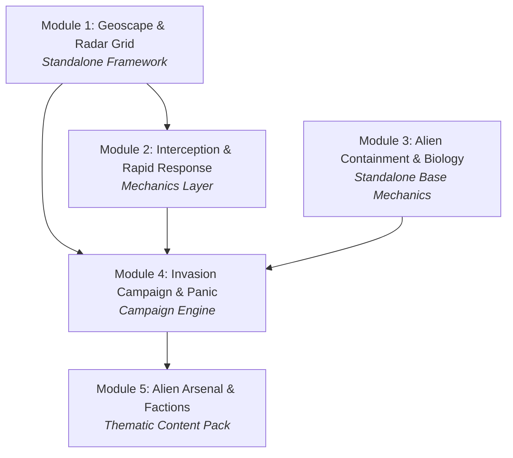

# Modular System Architecture

## 1. Overview

To ensure maintainability, rapid iteration, and wide community adoption, the project is structured as a **suite of decoupled add-ons**.

Instead of a single monolithic mod that risks breaking with game updates or conflicting with other popular overhauls, each module has clearly defined boundaries. Several modules function as **standalone utilities** that benefit the wider RimWorld modding ecosystem even outside of an X-COM context.

---

## 2. Dependency Matrix

---

## 3. Module Breakdown

### Module 1: Geoscape & Radar Grid (`Rimworld-Geoscape`)

- **Role:** Planetary sensory framework.
- **Standalone Utility:** High. Any mod requiring radar, early warning systems, planetary fog of war, or hidden world locations can use this without any alien content.
- **Core Systems:**
  - `WorldObjectComp_Radar`: Attached to settlements or standalone world objects (listening posts, satellites).
  - Planetary sensory bubbles: Calculates detection range on the `WorldGrid`.
  - Detection probability algorithms based on craft altitude, size, and stealth signatures.
  - Hidden world objects / dynamic moving targets (`UFO_WorldObject`).
  - Aquatic sonar support for oceanic tiles (Terror from the Deep layer).

### Module 2: Interception & Rapid Response (`Rimworld-Interception`)

- **Role:** Aerial and orbital interception, long-range transport deployment.
- **Dependencies:** Soft dependency on Module 1 (for target vectors).
- **Standalone Utility:** Medium-High. Can be used for general military air-defence and rapid deployment.
- **Core Systems:**
  - Craft range, fuel consumption, speed, and armament loadouts.
  - Interception combat resolution (simulated tactical engagement dialogue or automated resolution).
  - Downed / crash-site generator (spawning temporary `SiteDef` instances with salvageable wreckage).
  - Deployment and extraction drop-zones for tactical response teams.

### Module 3: Alien Containment & Biology (`Rimworld-Containment`)

- **Role:** Live entity capture, alien autopsies, and reverse-engineering.
- **Dependencies:** None (Fully standalone).
- **Standalone Utility:** High. Expands medical research and prisoner interactions for any sci-fi or creature mod.
- **Core Systems:**
  - Stasis holding pods and secure containment cells.
  - Interrogation bills and alien autopsy work tables.
  - Knowledge discovery trees and reverse-engineering data points (synergises with vanilla 1.5 / Anomaly study mechanics if present, but functions independently).

### Module 4: The Invasion Campaign & Panic (`Rimworld-Campaign`)

- **Role:** The overarching strategic game loop, global doom clock, and geopolitics.
- **Dependencies:** Requires Module 1, Module 2, and Module 3.
- **Core Systems:**
  - Planetary faction funding and Council evaluations (monthly performance reviews).
  - Regional panic metrics per faction/territory.
  - Alien strategic AI: Schedules scouting runs, harvest waves, terror raids, and alien base construction.
  - Escalation clock ("Avatar-style" invasion progress counter) with counter-operations.

### Module 5: Alien Arsenal & Factions (`Rimworld-XCOM-Theme`)

- **Role:** Pure thematic content pack.
- **Dependencies:** Requires Module 4.
- **Core Systems:**
  - Faction definitions: Ethereal/Alien Invaders, Advent/Infiltrators, Deep Ones/Aquatic invaders.
  - Xenobiology: Sectoids, Floaters, Chryssalids, Mutons, Aquatoids, Gillmen, Tentaculats.
  - Arsenal: Laser, Plasma, and Sonic weaponry.
  - Armour tiers: Kevlar, Carapace, Titan, Diving/Aqua-suits, Power Armour.
  - Audio and visual assets faithful to the original series.
