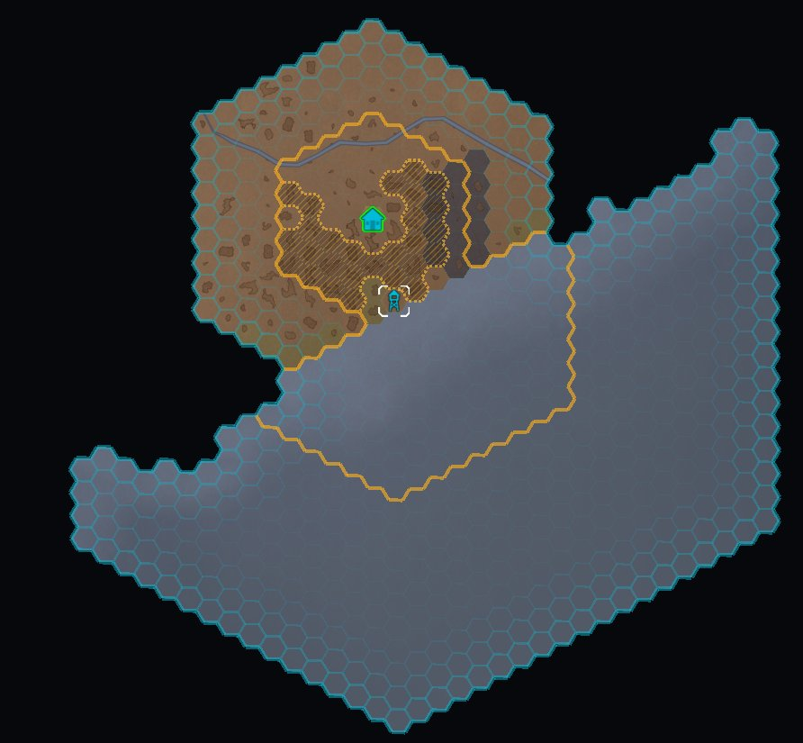
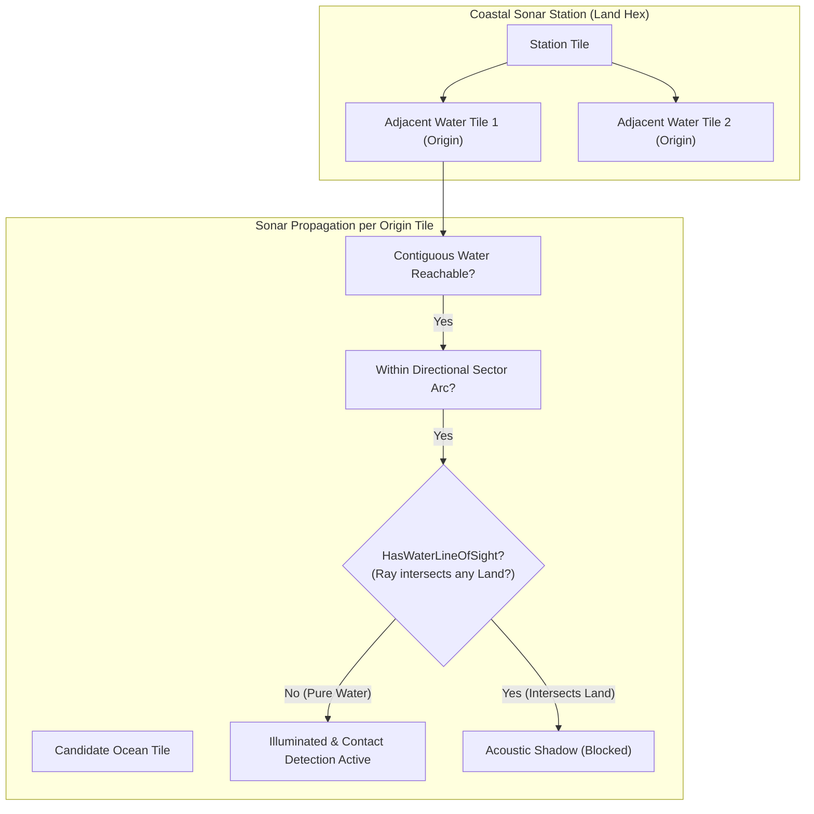

# Implementation Plan: Oceanic Sonar Line-of-Sight & Land Shadowing

## Current Decision

**Deferred: keep current sonar behaviour.** Do not implement the proposed hex-ray line-of-sight change or build a general-purpose terrain visibility system. Sonar continues to propagate through connected water in its existing directional sectors; land is not traversable, but coverage may travel through water around a headland.

The proposed hard-shadow rule is a gameplay change, not a necessary consequence of water-only propagation. It could also add geometric checks to coverage calculations that are recomputed during target evaluation. The proposed tile-centre ray would not, by itself, support mountain or altitude occlusion: current terrain masking uses hilliness-based vantage bonuses and target classification rules, not ray-based visibility. Reconsider sonar-specific shadows only if playtesting shows the wraparound behaviour is a meaningful problem; define the rule and measure its cost before implementation. Potential mountain reuse alone is not a reason to build this system.

## Goal Description

In Project Vigilance, **Oceanic Sonar** (provided by Coastal Hydrophone Arrays `Geoscape_SonarArray` and Automated Sonar Stations `ListeningPostKind.AutomatedSonar`) is designed to track maritime contacts strictly across water bodies (`tile.WaterCovered == true`).

Currently, `SonarTraversalUtility.PopulateSonarCoverage` uses a graph-based Breadth-First Search (BFS) that traverses from neighbor to neighbor across water tiles. While it prevents entering land hexes directly, it allows sound to navigate through contiguous water around capes, peninsulas, and headlands, illuminating water bodies on the far side of landmasses where direct geometric line of sight is obstructed.

As observed in playtesting, a coastal sonar station built on the southern shore wraps around the peninsula and illuminates the western bay on the other side of the landmass:



The deferred proposal would implement a deterministic **Hex Ray Line-of-Sight (LOS)** algorithm in `SonarTraversalUtility`:

1. Sound radiates outward in straight sightlines from the station's submerged hydrophone origins (`adjacentWater`).
2. Any intervening land hex along the ray acts as an acoustic barrier and terminates visibility past that point.
3. Headlands, islands, and peninsulas cast physical acoustic shadows behind them, preventing sonar from wrapping around land.

---

## Deferred Design Trade-off

> [!IMPORTANT]
> **Strict Acoustic Ray Shadowing vs. Diffraction:**
> The proposal treats sound as travelling along straight acoustic vectors. If a straight ray from the submerged hydrophone origin tile (`originWaterTile`) to a candidate ocean tile intersects a land hex, that candidate tile would be shadowed and would neither receive the tactical honeycomb overlay nor detect submerged contacts. This is a simplified gameplay model, not a complete simulation of underwater sound propagation.
>
> If a colony is situated on an isthmus or peninsula with coastlines on multiple sides (e.g., East and West), having coastal access on both sides will allow hydrophones on each respective coast to cover their respective oceans independently, but neither can penetrate or wrap through the intervening land.

---

## Open Questions

Implementation is deferred. If reconsidered, confirm that hard sonar shadows are desirable gameplay, define deterministic hex-crossing and multi-origin visibility rules, and assess performance before proceeding.

---

## Deferred Proposal (Not Approved)



### Sensory System (`Geoscape/Source/Geoscape/Sensory`)

---

#### [MODIFY] [SonarTraversalUtility.cs](../Geoscape/Source/Geoscape/Sensory/SonarTraversalUtility.cs)

- Add `HasWaterLineOfSight(PlanetTile originWaterTile, PlanetTile targetTile)`:
  - Takes `originWaterTile` (the submerged hydrophone origin) and `targetTile`.
  - If `originWaterTile == targetTile` or they are immediate neighbors, returns `true` (both are water).
  - Obtains 3D tile centers $C_O$ and $C_T$.
  - Steps along the ray segment from $C_O$ towards $C_T$ across the hex grid:
    - At each step, evaluates forward neighbors (neighbors strictly closer to $C_T$ than current).
    - Identifies the forward neighbor closest to the line segment $C_O \to C_T$.
    - If the best forward neighbor (or all tied forward candidates) is NOT water (`!IsTileWaterCovered`), the ray has struck land: returns `false`.
    - If water, advances `current` to that tile and repeats until reaching `targetTile`.
  - If tile centers are unavailable (e.g. topological tests without coordinates), falls back to verifying that the candidate tile is within valid directional reach.
- In `PopulateSonarCoverage`:
  - When evaluating candidate water tiles during outward propagation, filter through `HasWaterLineOfSight(originWaterTile, current)`.
  - Discard shadowed tiles from `outDetectionTiles`, `outIdentificationTiles`, and `outMinSteps`.
  - Stop BFS expansion down paths that have entered an acoustic shadow so sound does not wrap around headlands into hidden bays.

---

### Unit & Regression Tests (`Geoscape/Source/Geoscape.Tests`)

---

#### [MODIFY] [Milestone13FixesTests.cs](../Geoscape/Source/Geoscape.Tests/Milestone13FixesTests.cs)

- Add comprehensive test cases verifying:
  1. `SonarTraversalUtility_PeninsulaWrapAround_IsShadowedAndBlocked`:
     - Models a peninsula with an adjacent bay connected via water around the tip.
     - Verifies that water in direct line of sight is illuminated.
     - Verifies that water in the bay behind the peninsula is blocked by land shadow.
  2. `SonarTraversalUtility_OffshoreIsland_CastsAcousticShadow`:
     - Models an open ocean with a single-hex island.
     - Verifies tiles in front of and to the sides of the island are visible.
     - Verifies tiles directly in the geometric shadow behind the island are blocked.
  3. `SonarTraversalUtility_StraightCoastline_PreservesLongShorelineVision`:
     - Verifies that parallel line-of-sight along an open coastline is not falsely occluded by adjacent inland tiles.

---

## Deferred Verification Plan (Only If Reconsidered)

### Automated Tests

Run full test suite via `dotnet test`:

```bash
XDG_RUNTIME_DIR=/tmp dotnet test Geoscape/Source/Geoscape.slnx
```

Expect: All 400 existing tests + new Sonar line-of-sight tests passing with 0 errors.

### Manual Verification

1. Run `./scripts/deploy-geoscape.sh` to compile and deploy the updated assembly to RimWorld's Flatpak Mods directory.
2. Launch RimWorld and load the save containing the coastal sonar array shown in the screenshot.
3. Open the World Map:
   - Verify the coastal sonar station projects cleanly into the open ocean.
   - Verify that the blue honeycomb overlay terminates immediately where the land begins and **does not** appear in the bay on the other side of the peninsula.
   - Verify that moving water contacts across the open ocean are detected, while any contacts in the shadowed bay remain hidden until entering direct line of sight.
