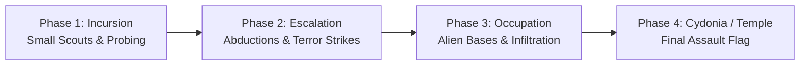

# Module 4 Specification: The Invasion Campaign & Panic

## 1. System Overview

The **Invasion Campaign & Panic** module provides the overarching strategic clock and geopolitical pressure. It unites the Geoscape, Interception, and Containment modules into a cohesive campaign against the alien invasion.

---

## 2. Global Geopolitics & Funding Council

Planetary factions (Empire, Outlanders, Civil Outlanders, Tribals, etc.) form a global defensive pact, providing regular funding and bounties:

```
┌────────────────────────────────────────────────────────────────────────┐
│                   COUNCIL OF NATIONS: MONTHLY REPORT                   │
├────────────────────────────────────────────────────────────────────────┤
│ Performance Grade: A-               Global Panic Level: Moderate (34%) │
│                                                                        │
│ Faction Contributions:                                                 │
│ • Western Union (Outlanders) : $3,200 Silver (Panic: Low - 15%)        │
│ • Broken Ridge Confederation : $1,800 Silver (Panic: High - 68%)       │
│ • Coastal Commonwealth       : $2,400 Silver (Panic: Critical - 84%)   │
│                                                                        │
│ Monthly UFO Interceptions: 7 Downed / 2 Escaped                        │
│ Terror Missions Addressed: 1 Resolved / 0 Ignored                      │
│                                                                        │
│ Council Directive: Coastal Commonwealth panic is reaching critical     │
│ threshold. If terror operations continue, they will sign an Alien Pact.│
└────────────────────────────────────────────────────────────────────────┘
```

### 2.1 Regional Panic Dynamics

- **Panic Increases When:**
  - UFOs operate undetected or unintercepted in faction territory.
  - Terror missions are ignored or failed.
  - Allied trade caravans are assaulted by alien scouts.
- **Panic Decreases When:**
  - UFOs are shot down within the region's airspace.
  - Crash sites and terror attacks are resolved successfully.
  - Player constructs forward radar listening posts protecting faction cities.
- **Pact Signing (Defection):**
  - If a faction's panic reaches 100%, they sign a non-aggression pact with the alien invaders.
  - Their monthly funding ceases, their settlements become hostile to X-COM, and alien infiltrators replace their leadership.

### 2.2 Geopolitical Fractures: Cults & EXALT (Ideology & Royalty Synergies)

- **Ideology — Fifth-Column Infiltration Cults (EXALT):**
  - As regional panic climbs above 60%, settlements have a chance to fracture, spawning pro-alien extremist cults (e.g., _"The Ascended Ones"_, _"Harbingers of the Sky"_).
  - Cultist splinter factions stage clandestine sabotage raids against player outposts: bombing power conduits, poisoning hospital stores, or liberating contained alien prisoners.
  - Players must conduct counter-intelligence operations to locate and eliminate cult headquarters.
- **Royalty — Imperial Council Patronage:**
  - The Shattered Empire acts as a premier Council funding partner, demanding high-level alien intelligence in exchange for orbital shuttle support, royal favours, and elite cataphract assault teams.

---

## 3. The Alien Strategic AI & Invasion Progression

The invasion operates across four escalating phases:



### 3.1 Alien Dark Events

Every quadrum, the alien high command initiates two covert operations (e.g., _"Alloy Scarcity: Armour production costs +50%"_, _"Stealth Cloaks: UFO detection radius -30%"_, or _"Infiltrator Cells: Hostile sleeper agents in allied settlements"_). Players can undertake high-risk pre-emptive strike missions to counter them.

---

## 4. Victory & Defeat Conditions

- **Defeat:**
  - More than 50% of planetary council factions defect / sign alien pacts.
  - The main player command headquarters is destroyed in an alien base defence assault.
- **Victory:**
  - Player researches and constructs the orbital assault craft or dimensional gate.
  - Successful assault on the Alien Command Dreadnought (Cydonia / Temple Ship equivalent).
