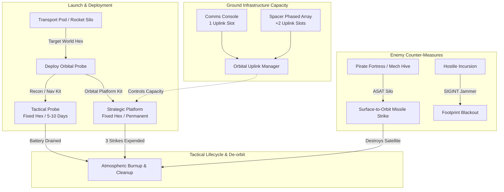

# Architectural Plan: Hybrid Orbital Networks, Targeted Tactical Probes & ASAT Warfare

## Goal Description

Overhaul Project Vigilance's orbital mechanics from exclusively drifting, perpetual satellites into a **hybrid orbital ecosystem**:

1. **Targeted Tactical Probes (Expendable & Time-Limited):** Allow players to deploy reconnaissance and navigation probes locked directly above a chosen planetary hex for a finite operational duration (5–10 in-game days), replacing random orbital drift with deliberate tactical intent.
2. **Strategic Platforms (Permanent, Uplink-Restricted & Balanced):** Maintain high-orbit strategic platforms (Military fire-control and Comms relays) constrained by a hard **Ground Uplink Channel Capacity** (X-COM style) and strict **charge/cooldown limits** to prevent spammable encounter trivialisation.
3. **Space Junk Prevention (Automatic De-orbit):** Expired probes and depleted military platforms automatically burn up in the atmosphere, preventing unbounded save game bloat and visual map clutter.
4. **Enemy Countermeasures (Anti-Satellite / ASAT):** Introduce hostile surface-to-orbit missile silos at pirate outposts, electronic warfare (SIGINT jamming) on incursions, and comms console sabotage raids, turning orbital dominance into a contested strategic battlefield.

> [!NOTE]
> This plan defines the complete architecture for scheduling into a future milestone (Milestone 1.6: Tactical Orbital Warfare & Targeted Probes). No runtime code modifications will be executed until this design is reviewed and approved.

---

## User Review Required

> [!IMPORTANT]
> **Hybrid Orbit Separation:**
>
> - **Commercial Trade Satellites** remain **Drifting Keplerian** orbits (global fleet capped at 2–3 vessels) to preserve the organic storyteller visit cadence across player and NPC colonies.
> - **Tactical Probes (Recon, Nav)** become **Stationary Geostationary** devices locked above the launch hex, with a hard countdown timer (e.g. 7 days).
> - **Strategic Platforms (Military, Comms)** become **Stationary Geostationary** devices supported by ground base infrastructure.

> [!WARNING]
> **Military Satellite Balancing:**
> To prevent trivialising world encounters, Military Satellites will feature a dual restriction:
>
> 1. **Finite Kinetic Charges:** Exactly 3 strikes per satellite before complete payload exhaustion and forced de-orbit.
> 2. **Capacitor Recharge Cooldown:** 3 in-game days (180,000 ticks) recharge between strikes, requiring 2,000W active colony power from a linked Comms Console.

> [!CAUTION]
> **Enemy ASAT Lethality:**
> Hostile pirate bases equipped with ASAT silos will project an interception bubble. Satellites placed or drifting over active ASAT sectors will be intercepted and destroyed after a 12-hour warning window unless the player clears the base or neutralises the silo.

---

## Architecture Overview



---

## Proposed Changes

### 1. Core Orbital Physics & Ground Track Extension

#### [MODIFY] `Geoscape/Source/Geoscape/Orbital/IOrbitalEntity.cs`

- Add `OrbitalStationkeepingMode StationkeepingMode { get; }` enum:
  - `DriftingKeplerian`: Standard drifting ground tracks (Trade Satellites, unmaintained stations).
  - `StationaryGeosynchronous`: Pinned to fixed geographic surface hex coordinates ($\vec{P} = \text{const}$).
- Add `int TicksRemaining { get; }` and `bool IsExpendable { get; }` for finite lifespan tracking.

#### [MODIFY] `Geoscape/Source/Geoscape/Orbital/OrbitalFlightModel.cs`

- Add support for `StationaryGeosynchronous` orbit calculations:
  - Evaluates fixed sub-satellite direction vector matching the target world hex center:
    $$\hat{P}_{\text{stationary}} = \text{Find.WorldGrid.GetTileCenter}(T_{\text{target}}).\text{normalized}$$
  - Maintains orbital render altitude above the fixed tile ($h_{\text{altitude}} = 20\text{--}35$ units).

---

### 2. Lifespan, Battery & De-Orbit Engine

#### [NEW] `Geoscape/Source/Geoscape/Orbital/CompOrbitalLifespan.cs`

- WorldObject component managing power/propellant decay for tactical probes:
  - `int lifespanTicksTotal`: Initial fuel capacity (e.g. 420,000 ticks / 7.0 days).
  - `int lifespanTicksRemaining`: Remaining operational ticks.
  - Scribe serialisation for save/load persistence.
  - Telemetry inspect string integration:
    `Battery Reserve: 4.8 days remaining (Stationkeeping Active)`
  - When `lifespanTicksRemaining <= 0`:
    1. Dispatches neutral notification: `"Tactical probe [Callsign] has exhausted its stationkeeping fuel and performed a controlled atmospheric burnup."`
    2. Deregisters from `OrbitalManager` and removes world object cleanly from `Find.WorldObjects`.

```csharp
public class CompOrbitalLifespan : WorldObjectComp
{
    public int TicksRemaining;
    public int TicksTotal;

    public float FractionRemaining => (float)TicksRemaining / Mathf.Max(1, TicksTotal);

    public override void CompTick()
    {
        base.CompTick();
        TicksRemaining--;
        if (TicksRemaining <= 0)
        {
            DeorbitAndDestroy();
        }
    }

    private void DeorbitAndDestroy()
    {
        string text = $"Orbital probe {parent.LabelCap} has exhausted its stationkeeping propellant and burned up in the upper atmosphere.";
        Messages.Message(text, MessageTypeDefOf.NeutralEvent, false);
        Find.WorldObjects.Remove(parent);
    }
}
```

---

### 3. Ground Uplink Channel Capacity (X-COM Style)

#### [NEW] `Geoscape/Source/Geoscape/Orbital/OrbitalUplinkManager.cs`

- WorldComponent managing player orbital capacity:
  - Calculates total active uplink channels:
    - Base `Building_CommsConsole`: +1 channel per powered console.
    - `Geoscape_RadarPhasedArray`: +2 channels per powered dish array.
    - Dedicated `Geoscape_SatelliteUplinkTerminal` (optional high-tech facility): +4 channels.
  - Compares active player strategic satellites against total capacity.
  - Prevents launching strategic satellites if `ActiveStrategicCount >= MaxChannels`.
  - If a power outage or destruction reduces capacity below active count:
    - Satellites enter `Telemetry Offline (Uplink Starved)` state until power/console restored.

---

### 4. Balanced Tactical Probes vs Strategic Platforms

| Platform                        | Role                    | Mode                 | Lifespan           | Launch Mechanism             | Gameplay Effect                                                             |
| :------------------------------ | :---------------------- | :------------------- | :----------------- | :--------------------------- | :-------------------------------------------------------------------------- |
| **Tactical Recon Probe**        | Reconnaissance          | Fixed Hex            | 7 days             | Pod / Mortar Launch          | Uncovers Fog of War, reveals all hidden camps/incursions in 16-tile radius. |
| **Tactical Nav Probe**          | Navigation              | Fixed Hex            | 10 days            | Pod / Mortar Launch          | Fixed 24-tile corridor granting +15% caravan speed.                         |
| **Strategic Military Platform** | Military / Fire Support | Fixed Hex            | 3 Strikes          | Heavy Rocket Launch          | Fixed 18-tile defense dome. 3 kinetic strikes (3-day cooldown).             |
| **Strategic Comms Relay**       | Communication           | Fixed Hex            | Permanent (Uplink) | Heavy Rocket Launch          | 32-tile trans-oceanic/mountain relay for remote outposts.                   |
| **Commercial Trade Satellite**  | Trade                   | Drifting (Keplerian) | Permanent          | Station Respawn (Fleet: 2–3) | Roaming global merchants with ~3.8 hr trade window.                         |

---

### 5. Military Satellite Strike Cooldown & Payload Depletion

#### [MODIFY] `Geoscape/Source/Geoscape/Orbital/WorldObject_Satellite.cs` (or specialized `Satellite_Military.cs`)

- Adds `int strikesRemaining = 3;`
- Adds `int rechargeCooldownTicks = 0;` (180,000 ticks = 3 in-game days).
- Ground Targeting Gizmo:
  - `Fire Orbital Kinetic Strike`:
    - Can target any hostile incursion or quest site within footprint.
    - Requires 2,000W reserve power at linked Comms Console.
    - If on battlescape map: Triggers orbital kinetic strike bombardment (similar to orbital bombardment targeter).
    - If on geoscape: Inflicts 50% casualty reduction / point reduction to target incursion.
    - Sets cooldown to 180,000 ticks.
    - Decrements `strikesRemaining`.
    - If `strikesRemaining == 0`, initiates self-deorbit.

---

### 6. Hostile Anti-Satellite (ASAT) Countermeasures

#### [NEW] `Geoscape/Source/Geoscape/Orbital/WorldObjectComp_AsatSilo.cs`

- Component attached to major Pirate and hostile Outlander bases:
  - Has an interception radius (e.g. 15 world tiles).
  - Detects low/medium orbit player satellites entering its airspace.
  - Dispatches an **ASAT Warning Letter**:
    > _"Hostile Surface-to-Orbit Silo Active: The pirate settlement at [BaseName] has acquired radar lock on our reconnaissance satellite. Unless the silo is disabled within 12 hours, surface-launched missiles will intercept our orbital asset."_
  - If base is not raided or satellite relocated within 12 hours:
    - Hostile missile intercept animation on globe.
    - Satellite destroyed.
    - Dispatches red alert letter (`ThreatBig`).

#### [NEW] `Geoscape/Source/Geoscape/Sensory/IncursionComp_EcmJammer.cs`

- Attached to high-tier mech incursions (e.g. Warqueen or Apocriton forces):
  - Emits a 6-tile radius **Electronic Warfare Bubble**.
  - Satellites passing overhead have their sensor footprint suppressed inside the bubble (marked as `SIGINT JAMMED: SENSORS BLINDED`).

---

## Verification Plan

### Automated Unit Tests (`Geoscape.Tests`)

1. **Lifespan Decay & Burnup Test:**
   - Verify `CompOrbitalLifespan` ticks down correctly.
   - Verify satellite de-orbits and deregisters from `OrbitalManager` at tick 0 without NRE.
2. **Fixed Hex Geostationary Positioning Test:**
   - Verify `StationaryGeosynchronous` coordinates remain identical across 10,000 ticks.
   - Verify `IsTileWithinFootprint` returns true for tiles within radius of the stationary target.
3. **Uplink Channel Capacity Enforcement Test:**
   - Verify 1 Comms Console allows 1 strategic platform; attempting a 2nd throws validation error.
   - Verify power loss toggles `Uplink Starved` state.
4. **Military Strike Cooldown & Ammo Depletion Test:**
   - Verify strike decrements charge count from 3 to 2 to 1 to 0.
   - Verify strike cannot be triggered while cooldown timer is active.
   - Verify 0 charges triggers de-orbit.
5. **ASAT Silo Threat Detection Test:**
   - Verify satellite entering pirate ASAT envelope triggers 12-hour grace period and subsequent destruction.

### Manual Verification

1. Deploy a Tactical Recon Probe over a quest sector: verify it stays locked above the sector and reveals Fog of War continuously.
2. Fast-forward 7 days: verify the probe burns up and disappears with a clean notification.
3. Construct a Military Platform: fire 1 strike, verify 3-day cooldown on inspect pane and power draw.
4. Move satellite over a pirate base with ASAT silo: verify warning letter and missile interception.
